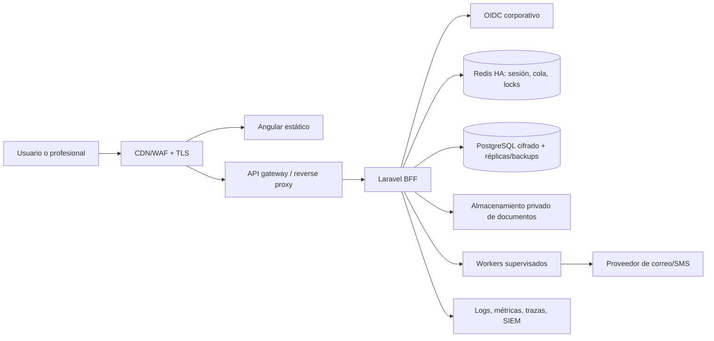

# Informe exhaustivo de preparación para producción — NexaSalud

**Fecha:** 26 de julio de 2026  
**Alcance revisado:** aplicación Angular, API Laravel, infraestructura Docker local, seguridad, calidad, pruebas, diseño y backlog.  
**Veredicto:** **no apta para producción todavía**. La aplicación contiene una base técnica prometedora y varias capacidades reales, pero tiene bloqueos funcionales, seguridad pendiente y una cantidad sustancial de producto sin terminar.

> Este informe es una revisión de ingeniería y producto. No sustituye una auditoría de seguridad independiente, una certificación de cumplimiento legal, una DPIA, una validación clínica ni una prueba de carga de producción.

## Actualización de implementación — 4 de agosto de 2026

Se implementaron capacidades pendientes del backlog sin escribir tests nuevos (la suite existente se mantiene y se ejecutó como validación):

**Lista de espera — ciclo completo de ofertas (backend + portal).** El ciclo de oferta ahora cubre ofrecer (vinculando una cita existente o reservando un hueco concreto mediante cita provisional), aceptar de forma atómica (con caducidad, verificación de que la cita sigue reservando agenda y prevención de doble asignación entre solicitudes), rechazar (vuelve a `waiting` y libera la reserva propia de la oferta), y caducar (lazy en aceptar/rechazar, acción manual del staff y comando programado `waitlist:expire-offers` cada 5 minutos vía scheduler). El paciente acepta o rechaza desde el portal con propiedad verificada y auditoría (`portal.waitlist_offer_accepted/rejected`); la lectura del portal marca `offer_seen_at`. Nuevas columnas `offer_seen_at` y `offer_created_appointment` en `waitlist_entries`.

**Consentimientos de paciente.** Nuevo `ConsentController` con listado (`patients.read`), registro de consentimiento versionado (`patients.write`) y retirada con motivo cifrado y auditoría, todos con paciente vinculado al centro activo y contrato API `GET/POST /api/v1/patients/{patient}/consents` y `POST .../consents/{consent}/withdraw`.

**Frontend.** La página de lista de espera del staff y la sección de espera del portal muestran el hueco ofrecido y permiten aceptar/rechazar/caducar con estados de carga, error y éxito; `WaitlistEntryResource` expone `offeredSlot` (hora, profesional y sala) sin PHI adicional.

**Validación ejecutada.** API: `phpunit` **104 tests / 541 aserciones** en verde (incluida la cobertura OpenAPI de todas las rutas nuevas vía Scramble) y Pint limpio en los 13 archivos modificados. Angular: `pnpm typecheck` verde y **30 archivos / 66 tests** en verde. Se corrigieron dos incidencias de tipo preexistentes (`prescriptions.ts` con `downloadPath` nullable y mocks de specs con el nuevo campo `offeredSlot`).

**Correcciones de revisión aplicadas (misma fecha).** El flujo de oferta del staff ahora incluye un formulario de hueco concreto (fecha/hora, modalidad, sala y profesional) porque el contrato exige reservar una cita real; se añadió un índice único parcial (`waitlist_entries_fulfilled_claim_unique` sobre `fulfilled_appointment_id` para estados `offered`/`booked`) que impide en base de datos la doble asignación de una misma cita bajo concurrencia; `destroy` libera la cita provisional propiedad de la oferta antes de cancelar la solicitud; la caducidad (lazy, manual y programada) limpia la referencia a la cita; `releaseOwnedReservation` falla de forma sonora si falta el profesional (sin fugas silenciosas de huecos); el comando programado captura fallos por entrada; y los mensajes de caducidad quedan alineados entre staff y portal. En el portal, `formatTime` ya no puede lanzar error con fechas nulas y aceptar una oferta refresca las citas.

**Motor automático de coincidencia de huecos (misma fecha).** Se implementó el motor pendiente de Task 2.2: el comando `waitlist:match-slots` (scheduler cada 5 minutos con `withoutOverlapping` y `onOneServer`) recorre tenants y clínicas activos configurando el contexto de tenant y RLS por ejecución (mismo patrón que `GenerateClinicalPdfJob`) y delega en el servicio `WaitlistMatchEngine`. El motor procesa las entradas `waiting` por prioridad y antigüedad, y para cada una busca el primer hueco libre que respete la ventana `desired_from/desired_to`, los días preferidos, el profesional preferido (si se indicó), el tipo de atención (duración, sala requerida, canal presencial), un lead mínimo configurable y el horario laboral del centro. La oferta se crea de forma atómica: lock de fila sobre la entrada, re-verificación de que sigue `waiting`, comprobación de conflicto contra citas y holds activos (paciente, profesional y sala), creación de la cita provisional con `offer_created_appointment=true` y auditoría `waitlist.offer_created_automatically` sin actor humano ni PHI. El motor está limitado por configuración (`config/waitlist.php`: `WAITLIST_MATCHING_ENABLED`, `OFFER_VALID_MINUTES`, `MAX_OFFERS_PER_RUN`, `LOOKAHEAD_DAYS`, `MIN_LEAD_HOURS`), con presupuesto por ejecución para evitar avalanchas de ofertas.

**Correcciones de revisión aplicadas (misma fecha).** Se acotó el escaneo por clínica con `max_entries_per_run` (configurable) para limitar el tiempo de CPU del scheduler; la ventana de búsqueda se recorta al día del lead mínimo para no iterar días pasados de entradas antiguas; y `AuditRecorder` deduplica la persistencia de eventos entre `record` y `recordSystem`.

**Pendiente reconocido.** Quedan fuera de esta pasada la generación proactiva de huecos a partir de plantillas de agenda (no existe modelo de agenda recurrente en el dominio), la notificación automática al paciente al crear una oferta por el motor (la visibilidad queda en el portal con `offer_seen_at`), el sesgo/prioridad explicables más allá del orden `priority` + antigüedad y el uso de canales alternativos (el motor oferta presencial, ignorando `allows_video`). Pint reporta incidencias de estilo preexistentes en unos pocos archivos no tocados (`PermissionService.php`, seeders/factories, `StoreAppointmentRequest.php`, `RecordQueuedCommunicationDispatch.php`). El veredicto global no cambia: la plataforma sigue **no apta para producción** hasta cerrar los bloqueadores funcionales, de validación independiente y de infraestructura descritos en este informe.

## Actualización de interfaz Material y resiliencia — 2 de agosto de 2026

Se consolidó el lenguaje visual del frontend alrededor del tema Material 3 (`mat.theme`) y de componentes Angular Material/CDK: tarjetas, botones, chips, formularios, toggles, menús, diálogos, estados y feedback. Los estados de carga, vacío, error y éxito reutilizan `StatePanel`; los estados de dominio se renderizan mediante `StatusChip`, que encapsula `mat-chip` y evita badges HTML divergentes. Los vacíos genéricos del portal también quedaron unificados en `StatePanel` y se retiró su CSS duplicado. El login OIDC/MFA mantiene la composición responsive validada en escritorio y móvil.

Se completó también la pasada de errores y eventos del frontend: los fallos de agenda, alta de paciente, administración y descargas generan `AppError` contextual, referencia de correlación, notificación deduplicada y recuperación segura; los eventos HTTP, autenticación, contexto, errores y avisos no transportan cuerpos, tokens, PHI ni identificadores de recursos. La redacción de rutas de telemetría oculta consultas e identificadores. Las notificaciones se anuncian también mediante CDK `LiveAnnouncer` con una politeness coherente, además del snackbar visual.

El presupuesto de bundle inicial de producción queda fijado explícitamente en **512 kB** para absorber el coste pequeño de la accesibilidad CDK sin warnings; el build actual mide **500,46 kB** iniciales y **126,98 kB** estimados transferidos.

Verificación local actual: `pnpm format:check`, `pnpm typecheck`, `pnpm --filter @nexasalud/web test:ci` (**30 archivos / 66 pruebas**) y `pnpm --filter @nexasalud/web build` pasan. La evidencia visual queda en `output/playwright/login-material-current.png` y `output/playwright/login-material-current-mobile.png`. Esta actualización mejora la preparación del frontend, pero no cambia el veredicto global de no aptitud para producción hasta completar la validación E2E, WCAG, infraestructura, pentest, cumplimiento sanitario y operación gestionada.

En la misma pasada se añadió estado de error local y recuperación a las mutaciones de comunicaciones, facturación, prescripciones, historia clínica, lista de espera y portal del paciente; el flujo de PDF de prescripción encadena generación y descarga con `switchMap` y finalización segura. Los selectores de modalidad, filtro de citas y contenido de salud del portal usan `mat-button-toggle-group`, con semántica radiogroup y teclado Material. La verificación repetida del 2 de agosto mantiene **30 archivos / 66 pruebas**, typecheck, formato, build de producción (**500,46 kB iniciales; 126,98 kB estimados transferidos**) y `pnpm audit --prod` sin vulnerabilidades conocidas. El interceptor también redacciona identificadores de comunicaciones y lista de espera en rutas de telemetría. La API se validó ahora con Docker Desktop operativo: `php vendor/bin/phpunit` pasa con **103 pruebas / 531 aserciones**, Pint queda limpio y `composer audit --locked --no-dev` no encuentra avisos. PHPUnit también confirma que las pruebas usan SQLite en memoria y cola `sync`, sin contaminar Redis/PostgreSQL local.

La pasada adicional de Material sustituyó los botones interactivos HTML planos de comunicaciones, agenda, shell, lista de espera y portal por directivas Angular Material (`mat-button`/`mat-icon-button`), manteniendo como excepciones explícitas el backdrop del menú y los selectores de reserva con tarjetas de radio personalizadas. Estos selectores conservan ahora navegación roving con flechas, Home/End y foco visible; una regresión cubre la selección por teclado. El contrato de eventos de sesión registra fallos de carga de sesión, opciones de contexto y logout únicamente con estado HTTP, código y correlación; dos regresiones nuevas cubren estos caminos sin transportar datos sensibles. La suite queda en **30 archivos / 66 pruebas**.

La ejecución operativa también validó `infra/scripts/verify.sh`: API, gateway, PostgreSQL, Redis, Keycloak, Mailpit y worker aparecen saludables; `/ready` devuelve `{"status":"ready"}` y `/auth/login` genera una redirección OIDC local 302 con PKCE S256, `state`, `nonce` y ACR. La configuración de producción fue comprobada con Docker Compose usando imágenes por digest; se corrigió el conflicto de Compose 5 entre `pids_limit` y `deploy.resources.limits` trasladando los límites de procesos al esquema moderno. Esto prueba el entorno local y la sintaxis del artefacto, pero no sustituye imágenes firmadas, secretos/KMS, WAF/TLS, servicios gestionados, restore, pentest ni aprobación legal sanitaria.

Se corrigieron los dos `compose.yaml` para que el servicio `api` declare el healthcheck FPM que ya exige el gateway mediante `condition: service_healthy`; ambos artefactos se validaron con Prettier. Esta corrección evita un despliegue bloqueado por una dependencia de salud no declarada, aunque la validación efectiva de imágenes, redes, secretos y servicios gestionados sigue requiriendo Docker y un entorno de staging.

## Actualización de implementación — 26 de julio de 2026

Las conclusiones históricas de bloqueo B-01, B-02 y B-05 que aparecen más abajo ya han sido corregidas y se conservan para trazabilidad. La aplicación **sigue sin estar lista para producción**: continúan bloqueadores de producto, cumplimiento, entrega y operación descritos en este informe.

| Elemento corregido              | Evidencia actual                                                                                                                                                                                                                                                        | Límite pendiente                                                                                                                                                                                                     |
| ------------------------------- | ----------------------------------------------------------------------------------------------------------------------------------------------------------------------------------------------------------------------------------------------------------------------- | -------------------------------------------------------------------------------------------------------------------------------------------------------------------------------------------------------------------- |
| Inicio OIDC                     | Se restauraron los value objects tipados de la transacción OIDC; el inicio local devuelve una redirección 302 real a Keycloak con PKCE S256, `state`, `nonce` y ACR. La suite cubre consumo único, replay, emisor, audiencia, rotación JWK, algoritmo y retorno seguro. | Falta validar el recorrido completo contra el IdP y las cuentas de producción, incluidos MFA, logout y recuperación.                                                                                                 |
| Directorio de equipo            | La ruta Angular usa `TeamApiService` y `GET /api/v1/team`, con carga, vacío, error, búsqueda y recarga. Se retiraron perfiles, turnos, métricas y acciones inventados.                                                                                                  | Aún faltan las capacidades administrativas completas (invitaciones, disponibilidad, exportación y gobierno de roles) respaldadas por API y auditoría.                                                                |
| Login                           | La pantalla se rediseñó como un launcher OIDC serio con Angular Material, estado de sesión y dos destinos reales, sin citas ficticias ni enlaces inertes.                                                                                                               | Debe pasar revisión visual, accesible y de navegadores en todos los breakpoints antes de lanzamiento.                                                                                                                |
| PDF                             | `dompdf/dompdf` se actualizó de 3.1.5 a 3.1.6. `composer validate` y `composer audit --locked --no-dev` están limpios; el contenedor reconstruido ejecuta con la versión corregida.                                                                                     | El render sigue requiriendo límites operativos y observabilidad de producción; no se debe aceptar contenido documental no validado.                                                                                  |
| Pruebas API                     | Tras los cambios, `php artisan test` pasa: 84 pruebas y 413 aserciones. Las cinco pruebas de PDF clínico también pasan.                                                                                                                                                 | Aún faltan contratos, E2E, carga, SAST/DAST y eliminar las pruebas `example` que no prueban comportamiento real.                                                                                                     |
| Directorio de pacientes         | La vista sustituyó filtros, paginación y enlaces decorativos por controles Angular Material, estado de carga, fallo recuperable, reintento y métricas derivadas exclusivamente de la colección autorizada.                                                              | Debe añadirse filtrado/paginación en servidor, pruebas E2E y una ficha detallada con autorización contextual antes de una salida clínica.                                                                            |
| Shell profesional               | Se retiraron clínica, centros, badges, notificaciones, búsqueda global e identidad de reserva; el shell usa exclusivamente el tenant, usuario y nivel de autenticación de la sesión.                                                                                    | Falta implementar el cambio de contexto y las notificaciones reales antes de volver a exponer esas acciones.                                                                                                         |
| Analítica                       | Se sustituyeron todas las cifras, gráficas, recomendaciones y exportación simuladas por `GET /api/v1/analytics`, con rango seleccionado, estados de carga/error, Material y prueba de regresión. La lectura queda auditada sin PHI.                                     | El contrato actual no cubre series temporales, ocupación por profesional, exportación ni analítica avanzada; esas capacidades no deben reintroducirse hasta que tengan un contrato agregado, autorización y pruebas. |
| Preferencias                    | Se retiraron las pestañas demostrativas de centros, horarios, integraciones, datos y seguridad. La vista persiste solo tema, densidad, movimiento, agenda, privacidad y notificaciones mediante `GET/PUT /api/v1/settings`.                                             | La administración clínica real requiere recursos, permisos, auditoría y contratos específicos; no debe volver a representarse como preferencias de usuario.                                                          |
| Mensajes del portal             | `GET /api/v1/portal/messages` devuelve solo comunicaciones de portal en cola para el vínculo paciente-usuario verificado. El cuerpo cifrado se descifra únicamente tras establecer propiedad, la lectura queda auditada y Angular muestra carga, error, vacío y lector. | El buzón es solo de lectura: faltan respuestas, adjuntos, asignación, SLA, confirmación de entrega y operación de colas antes de afirmar mensajería paciente-centro completa.                                        |
| Errores, trazas y documentación | API con problemas RFC 9457, `X-Trace-Id`, no-cache, validación segura y auditoría persistente. Los controladores, fábrica de errores y middleware críticos tocados incluyen PHPDoc en inglés con punto final.                                                           | Falta aplicar el estándar de PHPDoc a todo el backend y formalizar eventos de dominio con listeners, reintento e instrumentación antes de producción.                                                                |

El backlog incorpora explícitamente los requisitos solicitados de acabado Angular Material/CDK, animaciones accesibles, PHPDoc en inglés con puntuación consistente, eventos/listeners y depuración centralizada. Véase la sección 13.22 de `PLAN_MAESTRO.md`.

La última verificación del frontend completa `typecheck`, producción y pruebas: el bundle inicial es de 481,69 kB (122,47 kB estimados transferidos), no genera avisos de presupuesto CSS, y `pnpm test:ci` pasa con 21 archivos y 38 pruebas. Esto no sustituye las pruebas E2E, visuales o de accesibilidad manual que siguen siendo obligatorias antes de producción.

La revisión posterior localizó tres fuentes de interfaz que siguen siendo demostrativas y, por tanto, no pueden declararse terminadas: el shell aún incluye una clínica, identidad, centros y badges de notificaciones de reserva; `analítica` renderiza métricas, personas, recomendaciones y exportación sin contrato API; y las pestañas de configuración contienen datos y controles sin persistencia. Se añadieron tareas explícitas para retirarlas o convertirlas en verticales reales antes de producción.

### Actualización adicional — 27 de julio de 2026

La agenda dejó de renderizar una semana y disponibilidad ficticias. La navegación de día, semana y mes solicita el rango correspondiente a la API, comunica la zona horaria devuelta y presenta un estado recuperable si la carga falla. La nueva prueba de regresión confirma que muestra una cita autorizada y no vuelve a introducir el “siguiente hueco” ni la fecha literal anterior. La verificación de frontend queda en **22 archivos / 39 pruebas** correctas; el build de producción sigue limpio y en 481,69 kB iniciales (122,48 kB estimados transferidos).

Este avance no cambia el veredicto: siguen pendientes una alternativa accesible en lista para agenda, filtros/ocupación calculados por servidor, E2E, pruebas visuales y de accesibilidad, y los bloqueadores operativos de este informe.

### Actualización de backend — 27 de julio de 2026

El backend cuenta ahora con el evento de dominio `CommunicationQueued`, publicado después del commit para evitar que un listener procese una comunicación revertida. El listener `RecordQueuedCommunicationDispatch` se ejecuta en una cola aislada, sin transportar texto, destinatarios ni datos clínicos: aplica exclusión mutua por comunicación, tres intentos con backoff, throttle de excepciones, auditoría idempotente y un log estructurado que contiene solo IDs operativos, `trace_id` y tipo de excepción. La prueba de comunicaciones cubre consentimiento, cifrado, bloqueo optimista, replay idempotente y la emisión del evento; falta el adaptador de entrega real por canal, su dead-letter queue, métricas, alertas y operación de producción.

También se añadieron PHPDoc en inglés con punto final al controlador de comunicaciones, al registrador de auditoría y al proveedor de aplicación. El estándar queda explícitamente pendiente para el resto del backend; no es correcto declarar la documentación completada hasta que la revisión sea global y esté automatizada.

### Actualización de entrega y calidad — 27 de julio de 2026

Se incorporó `.github/workflows/quality.yml` con tres jobs: frontend (Prettier, tipos, Vitest, build y auditoría), API (Composer, Pint, pruebas y auditoría) e imagen de producción. Dependabot revisará semanalmente npm, Composer y acciones. La línea base fue normalizada: Prettier pasa; Pint pasa en 257 archivos; Angular compila y sus 22 archivos/39 pruebas pasan; Laravel pasa con 83 pruebas/404 aserciones; las auditorías de producción de pnpm y Composer están limpias; y `docker build --target production` genera correctamente `nexasalud-api:ci`.

El workflow aún no tiene evidencia de ejecución remota ni protección de ramas porque la carpeta no contiene un repositorio Git conectado. Siguen siendo requisitos de lanzamiento: conectar un remoto protegido, ejecutar CI en pull requests, guardar artefactos/cobertura/SBOM, añadir SAST, escaneo de secretos, escaneo de imagen, E2E, pruebas visuales y pruebas de accesibilidad.

### Actualización de recuperación en frontend — 27 de julio de 2026

Angular incorpora ahora una vista Angular Material de recuperación para rutas inexistentes y errores no controlados del cliente. El `GlobalErrorHandler` mantiene la notificación contextual y, para fallos 5xx, dirige a una ruta segura sin exponer stack, SQL, token, URL interna ni contenido sensible. La página ofrece volver a ejecutar los guards del espacio de trabajo o ir al acceso seguro. La verificación visual de `http://localhost:4200/ruta-inexistente` confirma una jerarquía accesible, controles etiquetados y consola sin errores. La suite de frontend queda en **24 archivos / 42 pruebas**, incluyendo el manejo global de errores, y el bundle inicial en 482,27 kB (122,68 kB estimados transferidos), sin avisos de presupuesto.

Queda pendiente demostrar mediante E2E los errores 401/403/409/419/422/429 y 5xx de cada vertical, los estados offline/timeout, la preservación segura de formularios y la telemetría de errores sin PHI.

### Actualización de accesibilidad, documentación y depuración — 27 de julio de 2026

El shell autenticado incorpora un enlace de salto que aparece al recibir foco y lleva al contenido principal, evitando que una persona que navega con teclado recorra primero toda la navegación lateral. La regresión unitaria correspondiente eleva la suite Angular a **24 archivos / 43 pruebas** correctas. Este control no sustituye la revisión manual WCAG 2.2 AA, axe, lector de pantalla, zoom ni la alternativa en lista de la agenda, que permanecen como requisitos de salida.

En Laravel se documentaron los middleware de trazabilidad, contexto de tenant, no-cache e idempotencia con PHPDoc en inglés y punto final. `BACKEND_CONVENTIONS.md` explica el contrato RFC 9457, la correlación mediante `X-Trace-Id`, el tratamiento seguro de excepciones, los eventos/listeners y las reglas de depuración e incidentes sin PHI. No equivale a documentación global: siguen pendientes la cobertura total y un gate automático que la exija.

Como pasada de depuración posterior, el cambio fue formateado y `pnpm test:ci` finalizó en verde con 43 pruebas. Tras mover el patrón reutilizable del skip link al estilo global, el build Angular queda limpio de avisos de presupuesto en **482,54 kB** iniciales (122,74 kB estimados transferidos). Las verificaciones anteriores que permanecen vigentes son Pint limpio en 257 archivos, Laravel con 83 pruebas/404 aserciones, typecheck Angular, auditorías de dependencias limpias y revisión de navegador de login/recuperación sin errores de consola. El veredicto continúa siendo **no apta para producción** hasta cerrar los bloqueadores funcionales, operativos, de integración y de validación independiente descritos en este documento.

### Actualización de inicio operativo y mensajes seguros — 27 de julio de 2026

El dashboard recibe ahora `generatedAt` de la API y sustituye el indicador decorativo de actualización por una hora real emitida por el servidor en la zona horaria del centro. La prueba de contrato garantiza que el campo llega desde Laravel y la prueba Angular verifica que se muestra al usuario.

El portal activa la lectura de mensajes seguros ya publicados. `GET /api/v1/portal/messages` exige una sesión válida, tenant y vínculo paciente-usuario activo; limita los resultados, filtra por canal `portal` y estado `queued`, y registra `portal.messages_viewed` sin contenido en la auditoría. La UI muestra lista, lector, carga, error y vacío mediante Angular Material, pero no finge respuestas, adjuntos ni entrega externa. La prueba de backend demuestra que un paciente no recibe mensajes de otra persona, y el componente tiene regresión de interfaz.

La validación posterior queda en **25 archivos / 45 pruebas Angular**, build de producción limpio en **482,54 kB** iniciales (122,74 kB estimados transferidos), Pint limpio en **258 archivos** y Laravel en **84 pruebas / 413 aserciones**. El acceso público fue revisado visualmente en navegador sin errores ni avisos de consola; no fue posible validar visualmente el área autenticada sin utilizar credenciales, que no se han expuesto ni transmitido. El producto continúa **no apto para producción** hasta cerrar las capacidades, integraciones y controles de salida restantes.

### Evidencia de navegador actual — 2 de agosto de 2026

El informe de Codex Security quedó revisado: no identificó hallazgos reportables; señaló cinco superficies para seguimiento. Se reforzaron autorización y aislamiento de notas clínicas, visibilidad de motivos de cita por tenant/permisos y cancelación de citas con motivo obligatorio, versión optimista, política y auditoría. La suite API cubre esas regresiones y las auditorías de dependencias no encuentran avisos conocidos. Esta evidencia de código no sustituye un pentest independiente ni la aprobación de seguridad de producción.

La verificación se repitió con Chrome real en escritorio y en viewport móvil de 390 px: el título, `h1`, CTA OIDC, portal del paciente y foco por teclado son accesibles; el documento no produce overflow horizontal y no se observan excepciones JavaScript ni warnings. La única respuesta de error registrada es el `401` esperado de `GET /api/session` al entrar sin cookie: el guard lo transforma en estado anónimo y mantiene el launcher operativo. Las capturas actuales son `output/playwright/login-final.png` y `output/playwright/login-final-mobile.png`.

### Evidencia operativa actual — worker y cola

El worker de comunicaciones se reconstruyó con throttle por comunicación, backoff efectivo y exclusión de solapamientos. Se diagnosticaron y retiraron únicamente trabajos locales huérfanos que apuntaban a tenants eliminados; después se procesó un evento con entidades vigentes y la auditoría idempotente quedó registrada. La verificación final devuelve **0 trabajos pendientes, 0 delayed, 0 reservados y 0 `failed_jobs`** en las colas `default` y `communications`. Este smoke test es local y no sustituye un proveedor de mensajería ni un dead-letter queue gestionado en producción.

## 1. Resumen ejecutivo

> Nota de lectura: las subsecciones históricas que siguen conservan el diagnóstico original y su trazabilidad. Para el estado vigente, prevalece la actualización del 2 de agosto: el inicio local OIDC devuelve 302 y la API, frontend e infraestructura tienen las evidencias de validación indicadas arriba; los bloqueadores externos de producción siguen abiertos.

La interfaz no es un simple mockup en su totalidad: buena parte de los módulos Angular está conectada a endpoints reales y el backend posee modelo de datos, autorización, auditoría, cifrado y reglas de negocio. Sin embargo, la experiencia que se ve al abrir `http://localhost:4200/login` es una **pantalla de lanzamiento OIDC**, no un formulario de credenciales; esto es correcto para un BFF con proveedor de identidad externo.

El problema es que dicho flujo actualmente falla. La llamada real a `GET /auth/login?returnTo=%2Finicio` devuelve **HTTP 500**, porque el código importa clases que no existen en el repositorio: `OidcTransaction`, `OidcMetadata`, `OidcIdentity` y `OidcLoginResult` bajo `App\Services\Identity\Data`. Por tanto, nadie puede iniciar sesión y ninguna función autenticada está disponible de extremo a extremo.

La prioridad no debe ser añadir pantallas nuevas antes de resolver el acceso, la automatización de calidad y el contrato entre UI y API. Después hay que sustituir los datos estáticos, completar las capacidades clínicas y de portal que el propio backlog declara pendientes, y preparar una plataforma operable.

### Puerta de salida actual

| Área                                  | Estado                                                               | Decisión                                     |
| ------------------------------------- | -------------------------------------------------------------------- | -------------------------------------------- |
| Inicio de sesión y sesión             | Bloqueado                                                            | No publicable                                |
| Build Angular                         | Compila con 6 avisos de presupuesto CSS                              | Corregir antes de la salida                  |
| Tests Angular                         | 32/32 correctos                                                      | Base aceptable, insuficiente para producción |
| Tests API                             | 19 fallos, 63 correctos                                              | Bloqueado por identidad incompleta           |
| Formato API                           | 81 incidencias en 251 archivos                                       | Debe quedar limpio en CI                     |
| Dependencias JavaScript de producción | 0 avisos conocidos                                                   | Correcto en la fecha de revisión             |
| Dependencias PHP de producción        | 6 avisos en `dompdf/dompdf` 3.1.5                                    | Actualización obligatoria                    |
| Infraestructura                       | Docker local saludable; declarada explícitamente como desarrollo     | Falta arquitectura de producción             |
| Diseño y accesibilidad                | Dirección visual sólida, validación incompleta y pantallas estáticas | Revisión y pruebas obligatorias              |
| Trazabilidad de código                | No hay repositorio Git ni CI en la carpeta entregada                 | Bloqueador operativo                         |

## 2. Hallazgos bloqueantes de lanzamiento

### B-01 — El inicio de sesión OIDC está roto

**Severidad: crítica.** El botón de la pantalla de login llama a `/auth/login`; el gateway responde `500 application/problem+json` y evita exponer detalles, lo que es positivo, pero el producto queda inutilizable.

Evidencia:

- `apps/api/app/Services/Identity/Data/` no existe.
- `SecureKeycloakProvider`, `OidcDiscovery`, `SocialiteOidcClient`, `OidcUserResolver` y las pruebas de autenticación importan las cuatro clases ausentes.
- `pnpm test:api` terminó con 19 fallos asociados a esas clases.
- La petición real local a `/auth/login` devolvió HTTP 500.

**Trabajo necesario:** reconstruir esas DTO/value objects con tipos inmutables, límites de tamaño y validación estricta; completar PKCE, `state`, `nonce`, expiración, uso único y retorno seguro; recuperar y ampliar las pruebas de callback, replay, logout, selección de tenant y errores. Solo se podrá marcar resuelto tras un recorrido real Keycloak → callback → sesión → logout y pruebas negativas.

### B-02 — Dependencia de PDF vulnerable

**Severidad: alta.** `composer audit --locked --no-dev` detectó seis advisories en `dompdf/dompdf` **3.1.5**: cuatro de severidad media y dos baja. Incluyen lectura/oráculo de archivos a través de SVG y consumo de recursos mediante imágenes. La versión afectada es `< 3.1.6`.

**Trabajo necesario:** actualizar a una versión corregida, regenerar y revisar el lockfile, ejecutar las pruebas de PDF e introducir límites de tamaño/tipo de contenido, timeouts y aislamiento de recursos para la generación de documentos. Hasta entonces, no procesar contenido controlado por usuarios.

### B-03 — No existe una cadena de entrega reproducible

**Severidad: alta.** No se encontró `.git` ni directorio `.github`, y tampoco configuración de CI, despliegue productivo, infraestructura como código, análisis estático, SAST, escaneo de imágenes, pruebas E2E, OpenAPI ni monitorización.

Sin control de versiones y CI no existe una fuente verificable de verdad, revisión de cambios, rollback ni evidencia de que una versión liberada haya pasado las puertas de calidad.

**Trabajo necesario:** inicializar/reconectar Git remoto protegido; crear CI obligatorio para formato, tipo, unitarias, integración, E2E, build, `composer audit`, `pnpm audit`, SBOM, análisis de secretos, SAST y escaneo de contenedores; firmar/etiquetar imágenes por digest y documentar rollback.

### B-04 — La infraestructura incluida es explícitamente solo local

**Severidad: alta.** `infra/README.md` declara que usa HTTP loopback, Keycloak `start-dev`, Mailpit e identidades sintéticas y que no es receta de producción. El compose monta el objetivo `development`, expone servicios locales e incluye datos/credenciales de demo.

**Trabajo necesario:** entregar un manifiesto o Terraform/Helm de producción separado con TLS extremo a extremo, WAF/limitación, base de datos gestionada o endurecida, Redis gestionado, Keycloak/IdP HA, SMTP transaccional, almacenamiento de documentos cifrado, secretos en KMS/Vault, backups probados y observabilidad. Nunca promover este compose local a Internet.

### B-05 — Datos y acciones estáticas en el área de equipo

**Severidad: alta de producto.** La página `features/team` muestra cinco profesionales, métricas, turnos, ausencias, roles y botones definidos literalmente en el HTML. No usa el endpoint real existente `GET /api/v1/team`; sus botones no ejecutan operaciones. Es una representación visual, no una función operativa.

**Trabajo necesario:** sustituir todos los literales por servicios tipados, estados de carga/vacío/error, paginación/filtros del servidor, autorización por capacidad, auditoría y flujos reales para invitación, ausencia, cuadrante, exportación y administración de roles. No mostrar números o estados clínicos simulados en producción.

## 3. Qué ya existe y merece conservarse

### Frontend

- Angular 21 con componentes standalone, signals, carga perezosa, TypeScript estricto y pruebas Vitest.
- Angular Material y CDK están integrados (`@angular/material` y `@angular/cdk` 21.2.14). Se usan botones, formularios, selectores, checkbox, toggles y barras de progreso Material.
- Sistema visual coherente: tokens semánticos, tipografías Manrope/Newsreader, paleta clínica, modo oscuro, densidad, foco visible, `sr-only` y preferencia de movimiento reducido.
- Los módulos de dashboard, agenda, pacientes, notas clínicas, lista de espera, comunicaciones, prescripciones, facturación, auditoría, administración y portal disponen de servicios de acceso API tipados en muchos casos.
- El portal de paciente obtiene resumen, disponibilidad, reservas, cancelaciones, reprogramación y descargas mediante endpoints reales. Los nombres de clases CSS `demo-*` no implican por sí mismos datos falsos: varias de esas áreas sí consumen el resumen API.

### Backend y datos

- Laravel 13, PostgreSQL, Redis y Keycloak, con sesión y cola en Redis.
- Aislamiento de tenant, middleware de usuario activo, vida máxima de sesión, rate limit por tipo de operación e idempotencia para mutaciones sensibles.
- Restricciones PostgreSQL para evitar solapamiento de paciente, profesional y sala; historiales de cita, auditoría y prescripción protegidos contra mutación mediante triggers.
- Cifrado de campos clínicos, generación de documentos, auditoría y recursos API de dominios relevantes ya modelados.
- Validación fuerte de configuración de identidad en modo producción: exige HTTPS, origen exacto, cookie `__Host-`, sesión cifrada, Redis, CORS sin comodines, MFA/ACR fuerte, algoritmos permitidos y `APP_DEBUG=false`.
- Respuestas sensibles con `Cache-Control: no-store, private`, `Pragma: no-cache`, `X-Content-Type-Options: nosniff` y `Referrer-Policy: no-referrer`.
- El gateway local aplica usuario no privilegiado, filesystem de solo lectura, `no-new-privileges`, redes internas y puertos enlazados a loopback. Es una buena referencia de desarrollo endurecido.

Estas decisiones reducen el trabajo de base; no deben confundirse con validación funcional o cumplimiento completo.

## 4. Producto y funcionalidades pendientes

El `PLAN_MAESTRO.md` contiene 22 casillas cerradas y 273 abiertas. Esa cifra no es un porcentaje exacto de código, pero sí es el inventario de compromisos del propio proyecto: la mayor parte del producto definido permanece por entregar o demostrar.

### Identidad, administración y gobierno

- Resolver OIDC y completar los recorridos de login, MFA, recuperación, rotación/cierre de sesiones, passkeys, bloqueo por fuerza bruta, notificaciones de seguridad y step-up para acciones críticas.
- Implementar acceso por DNI únicamente en el proveedor de identidad si el negocio lo confirma; no introducir identificadores nacionales en URLs, logs ni búsquedas abiertas.
- Completar CRUD real de organización, sedes, recursos, profesionales, disponibilidad, vacaciones, sustituciones y permisos de mínimo privilegio.
- Terminar administración avanzada: invitaciones, revocación, roles personalizados, doble aprobación, break-glass, certificación periódica de accesos, retención y respuesta a incidentes.

### Pacientes, agenda y asistencia

- Alta completa de paciente, detección de duplicados, representante legal, contactos, coberturas, consentimientos, correcciones trazables, baja/rectificación/portabilidad y búsqueda resistente a enumeración.
- Agenda de lista, jornada, recursos, varias agendas, recurrencia, check-in, drag/resize con alternativa de teclado, zona horaria, bloqueos, retrasos, QR opaco y justificantes.
- El motor de agenda debe consolidar en una única fuente de verdad estados, reglas de transición, hold, idempotencia y notificaciones. Las reglas críticas han de residir en el servidor y base de datos, nunca solo en la UI.
- Lista de espera: motor de coincidencia, ofertas expirables, aceptación atómica, sesgos/prioridades explicables, derivaciones, autorizaciones y recalls.

### Historia clínica, prescripción y documentos

- Abrir/cerrar encuentros, notas estructuradas/versionadas, constantes, diagnósticos codificados, procedimientos, adjuntos, firma clínica y correcciones aditivas sin sobrescritura.
- Validar la normativa y las integraciones reales antes de presentar una receta como electrónica o dispensable; completar interacciones, alergias, conciliación y doble validación donde aplique.
- Documentos/consentimientos: plantillas versionadas, firma con evidencia, sellado temporal cuando proceda, retención, exportación y descarga con watermarks/permiso/auditoría.
- Laboratorio, imagen, interoperabilidad, pagos y videollamada requieren contratos, credenciales y pruebas con proveedores reales. Un adaptador local no equivale a integración productiva.

### Portal de paciente

- Existen acciones de reserva, cancelación, reprogramación, facturas/documentos y medicación, pero navegación marca como “No disponible” lista de espera, mensajes seguros, ayuda y privacidad/solicitudes. Deben completarse o eliminarse del lanzamiento.
- Añadir acceso delegado, consentimiento, comunicación segura, exportación/portabilidad, pagos tokenizados por un PSP, teleconsulta limitada por ventana y controles para no exponer disponibilidad o datos ajenos.

### Informes y operación

- Completar analítica con definiciones de métricas, filtros de autorización, límites de exportación, agregación/minimización y auditoría.
- Añadir tareas programadas y colas con reintentos, deduplicación, DLQ, panel operativo y alarmas; la cola configurada no basta si no hay workers supervisados ni SLO.

## 5. Revisión de diseño, Angular Material y accesibilidad

### Estado visual

La pantalla de login observada tiene una dirección visual cuidada: buena jerarquía, marca, aire, contraste aparente, CTA claro y composición de dos columnas. El hecho de que no tenga campos de usuario/contraseña es deliberado: debería redirigir al IdP externo. No obstante, el 500 actual convierte una pantalla bien diseñada en una experiencia fallida.

El diseño global aprovecha Material para controles, pero combina muchos componentes propios y CSS de alto detalle. Esto es válido si se conserva una biblioteca interna de componentes; no debe evolucionar como copias de CSS por pantalla.

### Trabajo de diseño imprescindible

1. Definir en Figma o equivalente un sistema de diseño versionado: tokens de color/espaciado/elevación/tipografía, variantes, estados, densidad, dark mode y reglas de contenido clínico.
2. Crear componentes Angular reutilizables sobre Material/CDK: shell, page header, toolbar, tabla accesible, filtros, empty/error/loading state, confirmación destructiva, panel lateral/dialog, chips de estado, selector de paciente y acciones auditables.
3. Sustituir la página `team` estática; todas las cifras, etiquetas, fechas y acciones visibles deben provenir del dominio y autorización actual.
4. Evitar sobreescribir internals MDC a gran escala. Encapsular tematización con APIs públicas de Angular Material para soportar upgrades.
5. Añadir `MatDialog`/CDK FocusTrap para overlays, `LiveAnnouncer` para operaciones asíncronas y Angular CDK a11y para foco, key manager y high contrast cuando corresponda.
6. Ejecutar auditoría real WCAG 2.2 AA: axe automatizado y revisión manual de teclado, lector de pantalla, foco, orden, contraste, zoom 200 %, reflow 320 CSS px, modo oscuro, alto contraste, reducción de movimiento, tablas y agenda compleja.
7. Comprobar que cada búsqueda tenga etiqueta accesible. Algunas ya usan `sr-only`; otras, como la búsqueda de equipo, no lo hacen todavía.
8. No usar el color como único indicador de estado y no poner PHI en tooltips, títulos, URLs, títulos del navegador ni mensajes de error.

### Rendimiento de interfaz

El build de producción entrega **482.15 kB iniciales** (estimación transferida 122.56 kB), bajo el aviso global de 500 kB. Esto es bueno, pero seis hojas de componente superan el presupuesto de 4 kB: login, analytics, patients, app-shell, audit y context-selection. No bloquean el build porque están bajo 8 kB, pero indican duplicación o componentes demasiado específicos.

Acciones: extraer patrones a tokens/componentes, vigilar el chunk inicial en CI, probar dispositivos de baja gama, usar `track` estable en listas y virtualización CDK para tablas, agenda y auditoría grandes.

## 6. Seguridad: fortalezas, brechas y requisitos

### Fortalezas verificadas

- Diseño BFF con sesión de servidor y OIDC en vez de tokens almacenados por la SPA.
- Validación productiva cerrada de HTTPS, CORS, cookies, MFA y algoritmos.
- Rate limiting para login, callback, sesión, logout, API clínica, mutaciones y PDF.
- Middleware de idempotencia que hashea la clave y el cuerpo canónico, bloquea concurrencia y reproduce respuestas correctas.
- Seguridad de respuesta, restricciones de red Docker y persistencia con triggers inmutables.
- No se detectó uso de `eval`, `new Function`, `document.write`, HTML inseguro ni bypass de sanitizer Angular. El único `localStorage` revisado persiste preferencias no sensibles de tema/densidad/movimiento.

### Brechas que cerrar antes de producción

1. Corregir B-01 y añadir pruebas de ataque OIDC (state/nonce/replay/issuer/JWK rotado/algoritmo no permitido/returnTo malicioso).
2. Actualizar Dompdf y aislar/limitar el render de PDF (B-02).
3. Definir cabeceras en el reverse proxy productivo: CSP con nonce o hashes, HSTS solo detrás de HTTPS confirmado, `frame-ancestors 'none'`, `base-uri 'self'`, `form-action`, `object-src 'none'`, `connect-src` estricto y `Permissions-Policy` mínimo. El Nginx local incluye XFO, XCTO, referrer y permisos, pero no una CSP/HSTS de producción.
4. Gestionar secretos solo mediante KMS/Vault, con rotación, acceso mínimo, auditoría y revocación. No usar `.env`, imágenes, logs, variables de CI sin protección ni datos de demo como fuente productiva.
5. Centralizar logs estructurados sin PHI/secretos, conservar auditoría en un destino inmutable separado y definir alertas para acceso anómalo, escalada de privilegios, exportación masiva, fallo de backup y fallos de login.
6. Aplicar protección DDoS/WAF y límites de payload, rate limits por cuenta/tenant/IP, validación de subida y antivirus/sandbox de ficheros.
7. Separar roles de infraestructura, soporte, clínica y auditoría; ejecutar revisiones periódicas y break-glass trazable.
8. Añadir análisis de secretos/SAST/dependencias/imagen a CI y una evaluación externa de pentest antes del go-live.
9. Realizar DPIA y validar jurisdicción, consentimiento, residencia de datos, retención, derechos del paciente, trazabilidad de firma y normativa sanitaria aplicable. “Cifrado” no equivale a cumplimiento legal.

## 7. Calidad, pruebas y observabilidad

### Resultado de comprobaciones ejecutadas

| Comprobación                           | Resultado                                                |
| -------------------------------------- | -------------------------------------------------------- |
| `pnpm typecheck`                       | Correcto                                                 |
| `pnpm --filter @nexasalud/web test:ci` | Correcto: 15 archivos, 32 pruebas                        |
| `pnpm --filter @nexasalud/web build`   | Correcto con 6 avisos CSS                                |
| `pnpm test:api`                        | Fallido: 19 fallos, 63 pruebas correctas, 287 aserciones |
| `pnpm lint:api`                        | Fallido: 81 incidencias de estilo en 251 archivos        |
| `pnpm audit --prod --json`             | 0 vulnerabilidades conocidas                             |
| `composer audit --locked --no-dev`     | 6 advisories Dompdf                                      |
| Stack Docker local                     | API/gateway/Keycloak/PostgreSQL/Redis/Mailpit saludables |

Las pruebas de backend que pasan cubren aspectos valiosos (tenant, cifrado PHI, auditoría, conflictos de citas, notas, documentos, comunicaciones, portal, prescripción y lista de espera). Pero hay archivos `tests/Feature/Feature/Api/V1` con pruebas de ejemplo y no existe evidencia de cobertura, E2E, contrato de API, carga, resiliencia, accesibilidad automática ni pruebas de navegador reales.

### Puerta mínima de calidad

- 0 errores de formato, tipos y build; 0 advisories sin evaluación/mitigación aprobada.
- Pruebas unitarias de dominio, integración con PostgreSQL/Redis/Keycloak, contratos de API, E2E de navegador y regresión visual de los recorridos críticos.
- Matriz de autorización y pruebas de aislamiento tenant/tenant, usuario/rol, paciente/delegado y lectura/exportación.
- Pruebas de concurrencia sobre reservas, holds, cancelación, idempotencia, exportación y firmas.
- Pruebas de recuperación: caída Redis, SMTP, IdP, DB, cola y dependencia de PDF; comportamiento seguro y mensajes utilizables.
- Prueba de carga con objetivos explícitos (p95/p99, errores, capacidad, RPO/RTO) y prueba de restauración de backup.
- Telemetría: logs correlacionados por trace ID, métricas RED/USE, health checks externos, tracing, alertas y runbooks.

## 8. Arquitectura de producción objetivo

Principios: SPA y BFF en el mismo origen cuando sea posible; cookies seguras; datos clínicos y documentos fuera de servidores efímeros; workers separados; servicios administrados o HA; mínimo privilegio por red e identidad; secretos fuera de Git; backup cifrado y restaurado de forma periódica; despliegues canary/blue-green con rollback.

## 9. Plan priorizado de ejecución

### Fase 0 — Recuperar una base liberable (bloqueante)

1. Restaurar las cuatro clases OIDC faltantes y completar autenticación real Keycloak.
2. Arreglar los 19 tests API, los 81 problemas Pint y los seis avisos de presupuesto CSS.
3. Actualizar Dompdf >= 3.1.6, revisar changelog y endurecer generación de PDF.
4. Convertir `team` de estático a API real o retirar la ruta/botones hasta terminarla.
5. Crear Git remoto, ramas protegidas, CODEOWNERS y CI obligatorio.

**Criterio de salida:** login/logout/MFA y una operación clínica autorizada funcionan E2E; CI verde sin excepciones.

### Fase 1 — Verticales clínicas completos

1. Elegir tres verticales para terminar de verdad: paciente → cita → encuentro/nota; lista de espera → oferta → reserva; factura/prescripción → documento autorizado.
2. Para cada vertical, entregar UI Angular Material, API, modelo/migración, autorización, auditoría, errores, pruebas unitarias/integración/E2E y telemetría.
3. Reemplazar toda métrica, acción y contenido estático por datos reales o eliminarlo.

**Criterio de salida:** ningún CTA visible queda sin efecto ni contiene datos inventados.

### Fase 2 — Seguridad y operación

1. Desplegar IaC productiva, TLS, CSP, secretos gestionados, backups, DR, logging/metrics/tracing y alertas.
2. Implementar hardening de Keycloak/IdP, administración de sesiones, recuperación y revisiones de acceso.
3. Añadir SAST, DAST autenticado, escaneo de imágenes, SBOM y pentest independiente.

**Criterio de salida:** prueba de restauración, simulacro de incidente y pentest con hallazgos críticos/altos resueltos o aceptados formalmente.

### Fase 3 — Diseño perfecto y accesibilidad

1. Consolidar biblioteca de componentes y tokens Material/CDK.
2. Corregir responsive, teclado, lector de pantalla, contrastes y estados en todos los recorridos críticos.
3. Incorporar pruebas visuales con viewport móvil/tablet/escritorio y dark/high-contrast.

**Criterio de salida:** WCAG 2.2 AA validado por pruebas automáticas/manuales y aprobación de diseño con datos reales.

### Fase 4 — Ampliación controlada

Completar las áreas pendientes del backlog (portal, integraciones, laboratorio, videollamada, pagos, inventario, informes) por incrementos verticales, solo tras disponer de contratos reales, responsables, cumplimiento y evidencia de pruebas.

## 10. Lista final de go/no-go

No autorizar producción mientras cualquiera de estos puntos sea “no”:

- [ ] ¿El login, MFA, callback, sesión, logout y expiración funcionan con el IdP productivo?
- [ ] ¿Todos los tests, formato, build, análisis y auditorías de dependencias están verdes?
- [ ] ¿No queda ningún dato, botón o métrica simulada visible para el usuario?
- [ ] ¿Cada acceso a PHI está autenticado, autorizado por tenant/rol/relación y auditado?
- [ ] ¿Los secretos, TLS, cookies, CSP, CORS, rate limits y PDFs han sido endurecidos y revisados?
- [ ] ¿Existen backup/restore, RPO/RTO, alertas, on-call, runbooks y rollback probados?
- [ ] ¿La UI ha pasado WCAG 2.2 AA, móvil, zoom, teclado y lector de pantalla?
- [ ] ¿Un tercero independiente ha revisado seguridad y cumplimiento sanitario aplicable?
- [ ] ¿Existe CI/CD trazable desde Git con artefactos/inventario de dependencias y aprobación de liberación?

## 11. Archivos clave revisados

- `apps/web/src/app/features/auth/pages/login/login.ts` y `apps/web/src/app/core/services/session.ts`: launcher OIDC de la pantalla de acceso.
- `apps/web/src/app/features/team/pages/team/team.ts` y `team.html`: área actualmente estática.
- `apps/web/src/app/features/patient-portal/data-access/portal-api.ts`: integración real del portal.
- `apps/web/src/styles.scss` y `apps/web/angular.json`: diseño Material, tokens y budgets.
- `apps/api/app/Providers/AppServiceProvider.php`: controles de producción para identidad/sesión.
- `apps/api/app/Http/Middleware/PreventSensitiveResponseCaching.php` y `EnforceIdempotency.php`: protecciones de respuesta y mutación.
- `apps/api/app/Services/Identity/`: imports de DTOs ausentes que rompen el login.
- `apps/api/Dockerfile`, `infra/compose.yaml`, `infra/nginx/default.conf`, `infra/README.md`: entorno local endurecido, no productivo.
- `PLAN_MAESTRO.md`: backlog y Definition of Done declarados por el proyecto.
