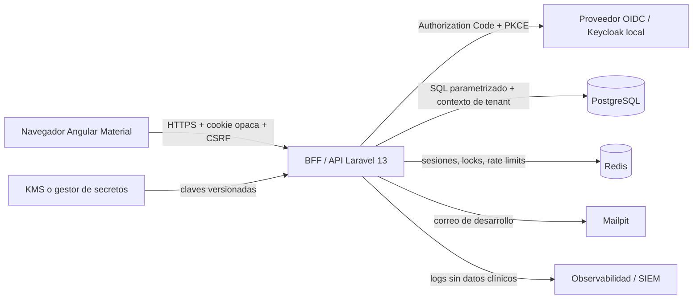

# Plan maestro — plataforma de gestión de citas médicas

> Estado: implementación en curso. Dirección visual A seleccionada; frontend Angular iniciado y arquitectura backend rebaselined a Laravel por petición del cliente.
>
> Nombre de trabajo: **NexaSalud Agenda**.
>
> Objetivo: entregar una aplicación web de gestión de citas médicas con Angular Material, experiencia de uso sobresaliente, personalización amplia, autenticación resistente a ataques, protección de datos sanitarios, pruebas automatizadas y una ejecución local reproducible.

## 1. Decisiones ejecutivas

1. **Angular 21 LTS y Angular Material 21 LTS.** Angular 22 es la versión activa más reciente, pero Angular 21 está en LTS y es compatible con el Node 24 disponible en este entorno. Para una aplicación sanitaria prima la estabilidad y el soporte de seguridad sobre adoptar una versión mayor recién publicada.
2. **Laravel 13 como BFF/API sobre PHP 8.4.** Un frontend Angular por sí solo no puede proteger datos de pacientes. Laravel concentrará autenticación, autorización, sesiones, validación, acceso a datos, colas, manejo de errores y auditoría. Laravel 13 recibe correcciones de seguridad hasta marzo de 2028 y PHP 8.4 está dentro de su matriz soportada.
3. **Identidad externalizada mediante OIDC.** No se inventará un sistema propio de contraseñas. En desarrollo local se usará Keycloak; en producción podrá sustituirse por un proveedor OIDC empresarial. El flujo será Authorization Code + PKCE y permitirá passkeys/WebAuthn, MFA y recuperación controlada.
4. **Sesiones únicamente en servidor.** El navegador recibirá una cookie opaca `HttpOnly`, `Secure`, `SameSite=Lax/Strict` y con prefijo `__Host-`. No habrá access tokens, refresh tokens ni datos clínicos persistidos en `localStorage` o `sessionStorage`.
5. **PostgreSQL como fuente de verdad.** Redis se reservará para sesiones, limitación de tráfico, bloqueos breves y colas. Los datos relacionales vivirán en PostgreSQL, con migraciones, restricciones y aislamiento por clínica.
6. **Seguridad verificable, no adjetivos.** “Extremadamente seguro” se traducirá a controles comprobables tomando OWASP ASVS 5.0 como base, NIST SP 800-63B-4 para autenticación y una amenaza modelada antes de exponer datos reales.
7. **Privacidad desde el diseño.** Los datos de salud son una categoría especialmente protegida bajo el RGPD. Se minimizará la información, se registrarán accesos, se cifrarán los campos de mayor sensibilidad y se evitarán datos reales en desarrollo y pruebas.
8. **Material 3 con identidad propia.** Se usarán componentes Angular Material/CDK, tokens de diseño y un tema original; no será un dashboard genérico ni una colección de tarjetas sin jerarquía.
9. **Animación con propósito.** Habrá microinteracciones, transiciones y ScrollFX suaves, pero nunca a costa de rendimiento, accesibilidad o concentración clínica. Todas respetarán `prefers-reduced-motion`.
10. **Entrega funcional por cortes verticales.** Cada fase terminará con una capacidad completa —interfaz, API, datos, permisos y pruebas— en lugar de construir muchas pantallas decorativas sin comportamiento real.

## 2. Alcance del producto

### 2.1 Usuarios y roles

La autorización se resolverá en servidor combinando RBAC y reglas contextuales. La interfaz ocultará acciones no permitidas, pero eso será solo una ayuda visual; la API volverá a verificar cada operación.

| Rol                                 | Capacidades principales                                    | Restricciones esenciales                                          |
| ----------------------------------- | ---------------------------------------------------------- | ----------------------------------------------------------------- |
| Administrador de plataforma         | Configuración técnica y estado del servicio                | No accede por defecto al contenido clínico de pacientes           |
| Administrador de clínica            | Sedes, equipos, horarios, tipos de cita y políticas        | Solo su organización; las acciones sensibles quedan auditadas     |
| Responsable clínico                 | Agenda global, profesionales, bloqueos y supervisión       | Acceso clínico según relación asistencial y política              |
| Profesional sanitario               | Agenda propia, pacientes asignados, cita y notas asociadas | Sin acceso masivo ni exportaciones por defecto                    |
| Enfermería/auxiliar                 | Preparación y seguimiento de citas autorizadas             | Visibilidad clínica limitada y configurable                       |
| Recepción                           | Alta básica, citas, confirmaciones y lista de espera       | Datos clínicos minimizados; campos sensibles enmascarados         |
| Responsable de privacidad/seguridad | Auditoría, accesos, incidentes, retención                  | Acceso a metadatos; contenido solo mediante elevación justificada |
| Auditor                             | Lectura de registros e informes autorizados                | Sin edición ni acceso general al contenido clínico                |
| Paciente                            | Sus propias citas, preferencias y consentimientos          | Únicamente su identidad y sus registros permitidos                |

### 2.2 Módulos funcionales

#### Acceso y seguridad de cuenta

- Inicio de sesión OIDC, passkey como método preferente y MFA obligatorio para personal.
- Selector de organización/sede cuando una persona pertenece a más de una.
- Cierre de sesión local y global, revocación de sesiones y lista de dispositivos.
- Reautenticación para exportar, modificar permisos, revelar datos especialmente sensibles o desactivar MFA.
- Avisos de nuevo dispositivo, actividad anómala y cambios de seguridad.
- Pantalla de bloqueo por inactividad sin revelar información del fondo.
- Recuperación mediante el proveedor de identidad, con códigos de recuperación tratados como secretos.
- Gestión de sesiones activas y botón “cerrar las demás sesiones”.

#### Inicio operativo

- Vista inicial centrada en la operación del día: próximas citas, pacientes en espera, huecos, retrasos y tareas urgentes.
- Acciones rápidas: crear cita, buscar paciente, bloquear franja, incorporar paciente y abrir lista de espera.
- Indicadores accionables: confirmaciones pendientes, cancelaciones, no presentados, ocupación y avisos.
- Modo privacidad que difumina nombres y datos identificativos hasta interacción intencional.
- Personalización de widgets por rol y usuario sin permitir que el cliente altere permisos.

#### Agenda y calendario

- Vistas día, semana, mes, lista y “mi jornada”.
- Filtros por sede, profesional, especialidad, consulta, modalidad, tipo y estado.
- Creación mediante formulario y selección directa de hueco.
- Arrastrar/redimensionar cuando el rol lo permita, con confirmación, alternativa de teclado y prevención de conflictos.
- Citas presenciales, telefónicas y por videollamada como modalidad.
- Duración, buffers anterior/posterior, color semántico, instrucciones y requisitos configurables por tipo.
- Repetición controlada, cita múltiple, bloqueo, ausencia y festivos.
- Comprobación de disponibilidad en cliente para feedback rápido y en base de datos como garantía final.
- Estados: pendiente, confirmada, llegada, en espera, en consulta, completada, cancelada y no presentada.
- Línea temporal “ahora”, agrupación por profesional y gestión de zonas horarias.
- Historial de cambios de cada cita con quién, cuándo y motivo.

#### Reserva y edición de citas

- Flujo por pasos: paciente, motivo/tipo, profesional/sede, fecha/hora, recordatorios y revisión.
- Búsqueda tolerante a errores sin exponer resultados excesivos.
- Detección de duplicados de paciente antes de crear uno nuevo.
- Bloqueo optimista de hueco durante unos minutos y control de concurrencia mediante versión del registro.
- Confirmación clara, posibilidad de deshacer cuando sea seguro y resumen imprimible sin datos innecesarios.
- Políticas configurables de cancelación, reprogramación y margen mínimo.
- Campos de “motivo” y “nota privada” cifrados y separados de etiquetas operativas no sensibles.

#### Pacientes

- Ficha mínima: identidad, contacto, preferencias, idioma, zona horaria, necesidades de accesibilidad y persona autorizada.
- Historial de citas con filtros, estados y trazabilidad.
- Consentimientos, base jurídica/configuración, versión del texto y fecha de aceptación o retirada.
- Preferencias de comunicación y ventanas horarias.
- Alertas operativas explícitamente autorizadas y con acceso restringido.
- Unión de duplicados mediante flujo de cuatro ojos y registro completo.
- Exportación restringida, marcada y auditada.
- La primera versión no intentará convertirse en una historia clínica electrónica completa: se limitará a lo necesario para la agenda.

#### Lista de espera

- Prioridad, rango de fechas, franjas, sedes y profesionales aceptables.
- Motor de coincidencias al liberarse un hueco.
- Oferta con caducidad y aceptación controlada para evitar dobles reservas.
- Registro de ofertas enviadas, aceptadas, rechazadas o expiradas.
- Automatización configurable con revisión humana para reglas de prioridad delicadas.

#### Recursos y disponibilidad

- Sedes, consultas/salas, equipos y profesionales.
- Horarios semanales, excepciones, festivos, vacaciones y bloqueos.
- Capacidad, requisitos de recursos y tiempos de preparación.
- Detección de solapamientos para profesional y sala.
- Plantillas de jornada reutilizables con fecha de vigencia.

#### Comunicaciones

- Notificaciones internas totalmente funcionales.
- Correo local mediante Mailpit en desarrollo y adaptador SMTP/proveedor en producción.
- Recordatorios configurables por tipo de cita, sede y preferencia del paciente.
- Plantillas con variables permitidas y previsualización; nunca se incluirá información clínica en asunto, SMS o notificaciones push.
- Registro de entrega, rebote, apertura solo si existe justificación y política de privacidad.
- Integración SMS desacoplada y desactivada mientras no existan credenciales; no habrá una simulación que finja envíos reales.

#### Informes

- Ocupación, cancelaciones, no presentados, tiempo de espera, anticipación de reserva y actividad por periodo.
- Agregación y anonimización cuando no sea necesario mostrar identidad.
- Exportación CSV/PDF solo para roles autorizados, con reautenticación, límites y auditoría.
- Filtros guardados por usuario y zona horaria consistente.

#### Auditoría y seguridad

- Registro de inicio/cierre de sesión, fallos, cambio de rol, exportación, lectura sensible, creación/edición/cancelación y cambios de configuración.
- Buscador por actor, acción, paciente seudonimizado, periodo y resultado.
- Integridad, retención y exportación a un sistema de logs separado en producción.
- Panel de sesiones, bloqueos, eventos sospechosos, políticas MFA y claves.
- Justificación obligatoria para accesos excepcionales “break glass”, con alerta y revisión posterior.

#### Configuración y personalización

- Tema claro, oscuro y automático; contraste reforzado; densidad cómoda o compacta.
- Tamaño de texto, reducción de movimiento, navegación lateral expandida/compacta y widgets del inicio.
- Idioma español inicial, arquitectura preparada para otros idiomas.
- Formato 12/24 horas, primer día de semana, zona horaria y formato regional.
- Duración por defecto, buffers, estados visibles, colores por tipo, políticas de cancelación y confirmación.
- Horarios, festivos, recursos, tipos de cita y plantillas de mensajes.
- Reglas por organización, sede, rol y usuario con precedencia explícita.
- Importación/exportación de configuración no sensible con validación previa.

## 3. Experiencia visual y diseño

### 3.1 Dirección visual propuesta

- Estética clínica contemporánea: limpia, serena, precisa y cálida, evitando tanto el blanco hospitalario frío como los degradados tecnológicos estridentes.
- Paleta base propuesta: tinta azul profunda, verde petróleo/teal como acción primaria, superficies marfil muy claras, grises azulados y coral reservado a avisos críticos.
- Material 3 personalizado mediante design tokens para color, tipografía, elevación, forma, densidad, estados y motion.
- Tipografía legible y autoalojada; nada de fuentes remotas que amplíen la superficie de privacidad o debiliten CSP.
- Iconos Material Symbols autoalojados y etiquetas textuales en acciones ambiguas.
- Radios moderados, sombras contenidas, bordes de alto contraste y superficies con jerarquía clara.
- Datos realistas sintéticos, no “Lorem ipsum”, para evaluar la densidad de una agenda real.

### 3.2 Layout

- Escritorio: navegación lateral adaptable, barra superior con contexto de sede, búsqueda global, privacidad, notificaciones y cuenta.
- Primer viewport: agenda y estado del día dominan el espacio; los indicadores secundarios no desplazan la tarea principal.
- Tablet: panel lateral colapsable, agenda horizontal con filtros en hoja inferior o drawer.
- Móvil: navegación inferior limitada a tareas frecuentes, creación de cita en flujo de pantalla completa y tablas convertidas a listas semánticas.
- Formularios en panel lateral cuando conservan contexto; diálogo solo para decisiones breves; página completa para procesos largos.

### 3.3 Animaciones, microinteracciones y ScrollFX

Principio: cada movimiento debe comunicar continuidad, estado, jerarquía o confirmación. Se evitará animar por adorno permanente.

- Transición entre rutas de 160–220 ms con leve desvanecido y desplazamiento de 6–10 px.
- Entrada escalonada de widgets solo en la primera carga, limitada a 3–5 elementos.
- Barra superior que compacta sutilmente al hacer scroll y conserva los filtros relevantes.
- Sombras y borde de secciones sticky que aparecen según intersección, no por listeners de scroll sin control.
- Scroll reveal de secciones de configuración, una sola vez, con `IntersectionObserver` y transformaciones aceleradas.
- Animación FLIP o equivalente al reordenar tarjetas configurables.
- Citas movidas en calendario con transición breve, ghost accesible y confirmación visible.
- Skeletons sobrios para cargas mayores de 200 ms; no usar spinners que bloqueen toda la pantalla salvo transición crítica.
- Estado guardado con icono/check y mensaje en live region; error con movimiento mínimo y foco dirigido.
- Contadores que cambian sin “slot machine”; el valor anterior se conserva para lectores de pantalla y se anuncia con moderación.
- Hover y focus coherentes, sin depender solo del color.
- `prefers-reduced-motion: reduce`: se eliminan parallax, desplazamientos, auto-scroll y transiciones no esenciales; se mantienen cambios instantáneos o fades muy cortos.
- Nada de parallax sobre tablas, formularios, calendarios o datos de pacientes.
- Objetivo de rendimiento: animar `transform` y `opacity`, evitar layout thrashing, usar `requestAnimationFrame` solo si es imprescindible y desconectar observers destruidos.

### 3.4 Accesibilidad

- Objetivo WCAG 2.2 nivel AA.
- Operación completa con teclado y foco visible no oculto por cabeceras sticky.
- Alternativa de teclado para drag and drop.
- Tamaños táctiles, contraste, zoom/reflow, anuncios ARIA y errores asociados a campos.
- Dialogs, menus y drawers con focus trap correcto y devolución de foco.
- Autenticación compatible con gestores de contraseñas y passkeys, sin pruebas cognitivas ni CAPTCHA inaccesible.
- Calendario con vista alternativa en lista para lectores de pantalla.
- Pruebas automáticas con axe y revisión manual de recorridos críticos.

## 4. Arquitectura técnica



### 4.1 Monorepo

Se usará un monorepo coordinado: `pnpm` para Angular y Composer para Laravel, sin introducir un orquestador adicional:

```text
apps/
  web/                 Angular 21 + Angular Material
  api/                 Laravel 13 + PHP 8.4, BFF y API
packages/
  design-tokens/       tokens de tema, densidad y motion
openapi/
  nexasalud.yaml        contrato HTTP canónico y versionado
  generated/            tipos TypeScript generados para Angular
infra/
  docker/              compose local: PostgreSQL, Redis, Keycloak, Mailpit
  keycloak/            realm de desarrollo sin secretos reales
  migrations/          migraciones revisables
docs/
  threat-model.md
  security-controls.md
  data-classification.md
  runbook.md
  privacy.md
```

### 4.2 Frontend Angular

- Standalone components, strict TypeScript y templates estrictos.
- Signals para estado local derivado; RxJS para flujos asíncronos, cancelación y eventos.
- Rutas lazy por dominio y guards solo como experiencia; la autoridad siempre está en API.
- Angular Material/CDK con tema Material 3 propio.
- Formularios reactivos tipados, validación compartida y mensajes claros.
- `HttpClient` con credenciales same-origin, interceptor de CSRF, correlación y manejo de errores.
- Sin renderizado de HTML arbitrario ni bypass de sanitización.
- CSP estricta, Trusted Types cuando sea compatible con todas las dependencias y dependencias sin `eval`.
- Estado persistente del navegador limitado a tema, densidad y preferencias inocuas.
- Calendario con componentes mantenidos y licencia compatible; si se usa FullCalendar, solo módulos MIT y estilos integrados con Material.

### 4.3 BFF/API

- Laravel 13 sobre PHP 8.4, con controllers finos, servicios de dominio, Form Requests, API Resources, Policies/Gates y middleware explícito.
- Laravel Sanctum en modo SPA/BFF para sesión mediante cookie; integración OIDC mantenida con Keycloak, validando issuer, audience, nonce, state, PKCE, timestamps y firma.
- Sesiones Laravel server-side en Redis con identificador aleatorio de alta entropía y regeneración tras autenticación/elevación.
- Protección CSRF nativa de Laravel/Sanctum, comprobación de `Sec-Fetch-Site` y validación estricta de `Origin`/`Referer` en mutaciones.
- CORS cerrado; en producción SPA y BFF comparten origen.
- Form Requests con reglas allowlist, DTOs inmutables y límites de tamaño/formato; API Resources impiden serializar columnas sensibles por accidente.
- Rate limiting por IP, sesión, actor y operación, con especial dureza en auth, búsqueda y exportación.
- Idempotency keys para creación de cita y envíos.
- `bootstrap/app.php::withExceptions` convierte fallos previstos a RFC 9457 con códigos estables, mensajes no reveladores y correlation ID; `APP_DEBUG=false` es obligatorio fuera de desarrollo.
- Monolog usa contexto allowlist y redacción centralizada: nunca registra cuerpos, cookies, autorización ni contenido clínico.
- OpenAPI generado/comprobado y tipos Angular derivados del contrato, nunca como sustituto de las pruebas.

### 4.4 Datos

- PostgreSQL con UUID/UUIDv7, fechas UTC y zona horaria explícita donde afecte a presentación o recurrencia.
- Todas las tablas de negocio incluirán `tenant_id` y políticas RLS; el BFF establecerá el tenant en una transacción.
- Restricciones de integridad y claves foráneas, no solo validación de aplicación.
- Exclusión de rangos para impedir solapamiento de profesional/sala en estados que ocupan agenda.
- Optimistic locking con `version`/`updated_at` para evitar sobrescrituras silenciosas.
- Borrado lógico solo donde esté justificado; retención y anonimización mediante trabajos explícitos.
- Campos de alta sensibilidad cifrados con AES-256-GCM, nonce único, AAD que incluya tenant/registro/campo y versión de clave.
- Claves maestras fuera de la base de datos; proveedor KMS en producción y clave local generada fuera de Git para desarrollo.
- Índices diseñados desde consultas reales y búsqueda identificativa restringida.

### 4.5 Modelo de datos inicial

Entidades principales:

- `tenants`, `clinics`, `rooms`, `resources`.
- `users`, `memberships`, `roles`, `permissions`, `role_assignments`.
- `provider_profiles`, `specialties`, `availability_templates`, `availability_exceptions`, `holidays`.
- `patients`, `patient_contacts`, `patient_preferences`, `consents`, `authorized_contacts`.
- `appointment_types`, `appointments`, `appointment_status_history`, `appointment_participants`.
- `waitlist_entries`, `slot_offers`.
- `notification_templates`, `notifications`, `delivery_attempts`.
- `user_preferences`, `organization_settings`, `setting_overrides`.
- `audit_events`, `security_events`, `break_glass_events`.
- `export_jobs`, `retention_jobs`, `idempotency_keys`.

Datos de cita esenciales:

- Tenant, sede, paciente, profesional, sala/recurso, tipo y modalidad.
- Inicio y fin UTC, zona horaria original, buffers y estado.
- Motivo cifrado, nota privada cifrada y etiqueta operativa no sensible separada.
- Origen de reserva, versión, creador/modificador, timestamps y motivo de cancelación.

## 5. Modelo de seguridad

### 5.1 Amenazas prioritarias

- Robo de cuenta por phishing, credential stuffing o recuperación débil.
- Secuestro/fijación de sesión y exposición de tokens en navegador.
- IDOR/BOLA: acceso a citas o pacientes de otra clínica o sin relación asistencial.
- Elevación de privilegios mediante cambios de rol o tenant manipulados.
- Inyección SQL, XSS almacenado/reflejado, CSRF, SSRF y carga maliciosa.
- Exfiltración por exportaciones, logs, telemetría, notificaciones o backups.
- Colisiones de reserva y corrupción por concurrencia.
- Abuso interno legítimamente autenticado.
- Dependencias comprometidas, secretos incluidos en código y configuración insegura.
- Denegación de servicio sobre búsquedas, agenda, login o generación de informes.

Antes del código sensible se generará un threat model con diagrama de flujo, activos, límites de confianza, actores, escenarios de abuso, controles y riesgo residual.

### 5.2 Controles de identidad

- MFA obligatorio para personal; passkeys/WebAuthn preferidas por resistencia al phishing.
- OTP solo como alternativa de menor garantía, con aviso y política.
- Step-up authentication para exportación, permisos, break-glass y cambios de seguridad.
- Política de sesión: idle timeout, absolute timeout, rotación, revocación y sesiones concurrentes configurables.
- Detección de reutilización de sesión y revocación inmediata al cambiar rol, contraseña o MFA.
- Login con mensajes que no permitan enumerar usuarios.
- Limitación progresiva y señales de riesgo sin bloqueos triviales explotables como DoS.
- No almacenar contraseñas en la aplicación. Si una implantación excepcional exigiera credenciales propias, se reevaluará el diseño y no se improvisará.

### 5.3 Autorización

- Denegar por defecto.
- Permisos explícitos como `appointments.read.own`, `appointments.manage.clinic`, `patients.read.assigned`, `exports.create`.
- Reglas contextuales: tenant, sede, equipo, relación asistencial, estado y sensibilidad.
- Comprobación en servicios y consulta de datos; nunca aceptar `tenant_id` o `role` del cliente como autoridad.
- PostgreSQL RLS como segunda barrera.
- Break-glass temporal, con motivo, duración, alerta y revisión.
- Matriz de pruebas negativas por rol y operación.

### 5.4 Aplicación y navegador

- TLS, HSTS, CSP con nonces/hashes, `frame-ancestors 'none'`, `object-src 'none'`, políticas de referrer y permisos mínimos.
- Cookies `__Host-`, HttpOnly, Secure, path `/`, sin Domain y SameSite adecuado.
- CSRF, validación de origen e idempotencia.
- Sanitización Angular; prohibidos `bypassSecurityTrust*`, `innerHTML` no controlado y plantillas dinámicas de usuario.
- Consultas parametrizadas y límites de respuesta.
- Subidas fuera del alcance inicial; si se incorporan, cuarentena, antivirus, magic bytes, límites y almacenamiento no ejecutable.
- Deshabilitar cache en respuestas sensibles y limpiar estado al cerrar sesión.
- No incluir PII/PHI en URL, títulos, nombres de archivo, métricas o errores.

### 5.5 Cifrado, secretos y registros

- Cifrado de disco/base de datos y backups en infraestructura.
- Cifrado de campos de mayor sensibilidad en aplicación con claves versionadas.
- Rotación de claves y migración en segundo plano; capacidad de descifrar por versión durante transición.
- Secretos en gestor dedicado; `.env.example` solo contiene nombres y valores seguros.
- Logs estructurados con allowlist de campos y redacción centralizada.
- Auditoría de lectura sensible además de escrituras.
- Los audit logs no almacenan el contenido clínico anterior/nuevo; registran identificadores seudonimizados, acción, actor, resultado y justificación.
- Alertas por exportaciones inusuales, búsquedas masivas, fallos repetidos y accesos cross-tenant bloqueados.

### 5.6 Privacidad y cumplimiento

- Inventario y clasificación de datos.
- Minimización y limitación de finalidad.
- DPIA/evaluación de impacto antes de producción cuando aplique.
- Base jurídica, consentimiento donde corresponda y trazabilidad de versiones.
- Políticas de retención configurables y legal hold.
- Derechos de acceso, rectificación, portabilidad/supresión sujetos a obligaciones sanitarias locales.
- Acuerdos con encargados, residencia de datos, backups y procedimiento de brechas fuera del código.
- No se afirmará “cumplimiento RGPD/HIPAA/ENS” sin auditoría jurídica y técnica del despliegue real.

## 6. Rendimiento, resiliencia y observabilidad

- Presupuesto inicial: LCP < 2,5 s en hardware/red objetivo, INP < 200 ms y CLS < 0,1 en vistas principales, medido y no asumido.
- Lazy loading por dominio, virtual scrolling para listas largas y paginación server-side.
- Agenda con ventana temporal, no carga ilimitada.
- Debounce/cancelación en búsquedas y caché privada de muy corta duración solo cuando sea segura.
- Jobs de recordatorio y exportación idempotentes, con reintentos acotados y dead-letter.
- Health/readiness sin información sensible.
- Métricas técnicas y de negocio agregadas; trazas con redacción.
- Backups cifrados, restauración probada, RPO/RTO definidos antes de producción.
- Degradación explícita: si falla correo, la cita se guarda y queda el recordatorio pendiente; si falla Redis, las operaciones sensibles fallan de modo seguro.

## 7. Estrategia de pruebas

### 7.1 Pirámide

- Unitarias: reglas de agenda, permisos, cifrado, validación, recurrencia, zonas horarias y formateo.
- Componentes Angular: Material Harnesses, formularios, foco, estados vacíos/error/carga.
- Integración API + PostgreSQL/Redis reales en contenedores.
- Contrato: OpenAPI y esquemas compartidos.
- E2E Playwright: login, nueva cita, conflicto, reprogramación, cancelación, lista de espera, permisos, privacidad, configuración y cierre de sesión.
- Accesibilidad: axe automatizado y recorrido manual de teclado/lector de pantalla en flujos críticos.
- Visual: capturas en desktop/tablet/móvil, tema claro/oscuro, densidad y reduced motion.
- Seguridad: SAST, SCA, secret scan, SBOM, comprobación de cabeceras, ZAP baseline contra entorno local y pruebas de autorización negativas.
- Rendimiento: tamaño de bundles, Lighthouse cuando proceda y pruebas de endpoints de agenda/búsqueda.

### 7.2 Casos de alto riesgo obligatorios

- Un recepcionista no puede leer notas cifradas ni forzar el endpoint.
- Un usuario de clínica A no puede inferir ni acceder a identificadores de clínica B.
- Cambiar IDs, tenant, role o rutas no altera autorización.
- Dos peticiones simultáneas no reservan el mismo profesional/sala.
- Un token CSRF ausente/incorrecto bloquea mutaciones.
- Logout/revocación invalida la sesión inmediatamente.
- Datos sensibles no aparecen en logs, URLs, errores ni almacenamiento web.
- Exportación requiere permiso, step-up, límites y deja auditoría.
- Reduced motion elimina ScrollFX no esenciales.
- Agenda funciona por teclado y tiene alternativa de lista.

## 8. Herramientas y dependencias

### 8.1 Skills de Codex

Disponibles y útiles:

- `sites:sites-building`: proceso de producto web y validación.
- `visualize:visualize`: composición visual y comparación de direcciones.
- `browser:control-in-app-browser`: inspección visual/interactiva.
- `playwright`: automatización real del navegador.
- `codex-security:threat-model`, `security-scan`, `validation` y `attack-path-analysis`: fases de revisión de seguridad.
- `imagegen`: únicamente si se decide crear un recurso visual original; la app no depende de ilustraciones.

Instaladas en esta fase y disponibles desde el siguiente turno:

- `security-best-practices`.
- `security-threat-model`.
- `screenshot`.
- `frontend-design` desde `anthropics/skills`: revisada antes de instalar, sin scripts ejecutables, licencia Apache 2.0 y compatible con el formato Agent Skills. Se usará para dirección visual, copy y motion, subordinada siempre a accesibilidad, Angular Material y seguridad clínica.
- `angular-developer` y `angular-new-app` desde el repositorio oficial `angular/skills`: generadas por el equipo Angular/Google, licencia MIT y snapshot del 16-07-2026. Se aplicarán respetando Angular 21 LTS y la política local de no instalar CLI global.
- `angular-material` desde `angular-sanctuary/angular-agent-skills`: licencia MIT, sin scripts, referencias generadas desde `angular/components` para Material 21.2. Se considera una guía secundaria; toda API se comprobará contra la versión estable instalada y documentación oficial.

No se instalarán skills de Figma, despliegues alternativos, Sentry o conectores externos sin una necesidad concreta o credenciales del usuario.

#### Resultado de la investigación de skills

| Candidata                                                                                         | Fuente/estado                                                              | Decisión                                               | Motivo                                                                                                                                                                 |
| ------------------------------------------------------------------------------------------------- | -------------------------------------------------------------------------- | ------------------------------------------------------ | ---------------------------------------------------------------------------------------------------------------------------------------------------------------------- |
| `security-best-practices`                                                                         | Catálogo curado oficial OpenAI                                             | Instalada                                              | Endurecimiento del stack y revisión de defaults inseguros                                                                                                              |
| `security-threat-model`                                                                           | Catálogo curado oficial OpenAI                                             | Instalada                                              | Amenazas, activos, trust boundaries y abuso cross-tenant basados en el repositorio                                                                                     |
| `screenshot`                                                                                      | Catálogo curado oficial OpenAI                                             | Instalada                                              | Evidencia visual de responsive, temas, densidad, motion y estados de error                                                                                             |
| `frontend-design`                                                                                 | Repositorio oficial `anthropics/skills`, Apache 2.0                        | Instalada tras revisar contenido y ausencia de scripts | Dirección estética no genérica, jerarquía, contenido y un gesto visual distintivo                                                                                      |
| `angular-developer`                                                                               | Repositorio oficial del equipo Angular/Google, MIT                         | Instalada                                              | Angular moderno: standalone, signals, DI, routing, accesibilidad, animaciones y tests, con detección de versión                                                        |
| `angular-new-app`                                                                                 | Repositorio oficial del equipo Angular/Google, MIT                         | Instalada                                              | Scaffold moderno con Angular CLI; se omite su sugerencia de instalación global en favor de CLI local reproducible                                                      |
| `angular-material`                                                                                | Comunidad Angular Sanctuary, MIT, generado desde `angular/components` 21.2 | Instalada con verificación obligatoria                 | Índice profundo de Material 3, CDK, theming y component harnesses; snapshot previo a 21.2 estable                                                                      |
| Laravel Boost y sus Agent Skills                                                                  | Laravel oficial, instalado como dependencia `--dev` dentro de la app       | Seleccionada; instalar tras el scaffold Laravel        | Herramientas, guidelines, skills y búsqueda documental ajustadas a Laravel 13 y a los paquetes Composer realmente instalados; evita guías comunitarias desactualizadas |
| Skills modulares AnalogJS (`angular-http`, `angular-forms`, `angular-signals`, `angular-testing`) | Comunidad AnalogJS, MIT                                                    | No instalar                                            | Duplicación; forms experimentales; ejemplos HTTP con bearer token/logging incompatibles con BFF y privacidad                                                           |
| `playwright`                                                                                      | Ya instalada                                                               | Usar                                                   | Pruebas E2E reales; evita duplicar tooling                                                                                                                             |
| `playwright-interactive`                                                                          | Catálogo curado OpenAI                                                     | Posponer                                               | Exige `js_repl`, no disponible en esta sesión; Browser + Playwright cubren el trabajo actual                                                                           |
| `frontend-skill`                                                                                  | Resultado indexado antiguo de OpenAI                                       | Descartada                                             | La carpeta ya no existe en la rama actual; no fijar una skill retirada o renombrada                                                                                    |
| `webapp-testing`                                                                                  | `anthropics/skills`                                                        | Descartada                                             | Duplica Playwright y añade un flujo Python menos integrado que el ya presente                                                                                          |
| `theme-factory`                                                                                   | `anthropics/skills`                                                        | Descartada                                             | Presets orientados a documentos/presentaciones; la app necesita tokens propios, no un tema genérico                                                                    |
| Skills Figma                                                                                      | Catálogo OpenAI                                                            | Posponer                                               | Útiles solo si el usuario decide trabajar con un archivo/sistema Figma y el conector correspondiente                                                                   |
| `sentry`                                                                                          | Catálogo OpenAI                                                            | Posponer                                               | Requiere servicio externo, DPA y redacción de datos; observabilidad sanitaria debe decidirse con el hosting                                                            |
| Skills de despliegue                                                                              | Catálogo OpenAI                                                            | Posponer                                               | No elegir proveedor antes de conocer residencia de datos, contratos, KMS, backups y requisitos legales                                                                 |
| Skills de terceros sin organización verificable                                                   | Internet                                                                   | No instalar                                            | Una skill puede introducir instrucciones o scripts; la cadena de suministro también es un riesgo                                                                       |

Fuentes de esta revisión: catálogo actual de `openai/skills`, contenido y licencias de `anthropics/skills`, requisitos declarados de cada skill y capacidades ya presentes en la sesión. La revisión se repetirá solo si aparece una necesidad concreta que las skills actuales no cubran.

### 8.2 Toolchain del proyecto

- Runtime local de Node 24 ya disponible para Angular; no instalar otro globalmente.
- `pnpm` ya disponible; se conservará un lockfile y versiones exactas.
- Angular CLI local, Angular 21.2.x y Angular Material/CDK 21.2.x compatibles.
- Laravel 13.x con PHP 8.4 y Composer 2, encapsulados en contenedores para un entorno reproducible.
- Laravel Sanctum para sesión SPA; Socialite/adaptador OIDC mantenido para Keycloak; Policies, Form Requests, API Resources, queues y scheduler.
- Laravel Boost como dependencia exclusiva de desarrollo, para skills y documentación versionadas del stack realmente instalado; nunca se despliega en producción.
- PostgreSQL, Redis, Keycloak y Mailpit en Docker Compose.
- Eloquent/Query Builder más migraciones Laravel y SQL explícito para RLS, exclusiones de rango y contexto de tenant.
- OpenID Connect mediante Socialite/proveedor Keycloak mantenido y validación JOSE del proveedor.
- Monolog/OpenTelemetry con procesadores de redacción.
- Vitest/runner oficial de Angular, Pest/PHPUnit y pruebas HTTP de Laravel, además de Playwright.
- axe-core para accesibilidad.
- Dependabot/Renovate se dejará preparado, no activado sin repositorio remoto.

Política de instalación:

- Ninguna dependencia global salvo que el sistema la exija.
- Versiones fijadas y lockfile comprometido.
- Revisar licencia, mantenimiento, CVEs, scripts de instalación y necesidad real.
- Preferir APIs nativas/Angular CDK frente a bibliotecas de efectos de scroll pesadas.
- No instalar GSAP solo para fades/sticky/reveals; CSS + Web Animations + IntersectionObserver son suficientes. Solo se reconsiderará si un flujo requiere una secuencia compleja que lo justifique.

## 9. Fases de ejecución y puertas de calidad

### Fase 0 — Preparación y decisiones visuales

1. Activar las nuevas skills instaladas.
2. Verificar Docker y los runtimes.
3. Crear exactamente tres direcciones visuales comparables para paleta/densidad/layout de agenda.
4. Elegir una dirección y fijar tokens de diseño/motion.
5. Crear threat model inicial y clasificación de datos.

Puerta: dirección visual seleccionada, arquitectura confirmada y riesgos críticos con controles asignados.

### Fase 1 — Scaffold reproducible

1. Crear workspace pnpm para Angular y aplicación Laravel/Composer coordinada desde el monorepo.
2. Activar strict mode TypeScript, `declare(strict_types=1)`, Larastan, Laravel Pint, tests, hooks y CI local.
3. Docker Compose con salud y volúmenes de desarrollo.
4. Configuración tipada, `.env.example` y generación segura de secretos locales.
5. Shell Angular Material responsive con datos sintéticos.

Puerta: instalación limpia, servicios saludables, build y tests base verdes.

### Fase 2 — Identidad, sesiones y autorización

1. Realm/configuración Keycloak local.
2. Flujo OIDC + PKCE BFF, cookies seguras, CSRF, logout y revocación.
3. Roles/permisos, selector de clínica y RLS.
4. Passkey/MFA y step-up en flujos sensibles.
5. Pruebas negativas y eventos de auditoría.

Puerta: ningún dato de negocio se expone sin sesión y autorización server-side; pruebas de aislamiento verdes.

### Fase 3 — Datos base y agenda vertical

1. Sedes, profesionales, pacientes mínimos, tipos y disponibilidad.
2. Agenda día/semana/mes/lista con filtros.
3. Crear, editar, mover, cancelar y completar cita.
4. Restricciones de solapamiento, idempotencia, locking y auditoría.
5. UX responsive, teclado y reduced motion.

Puerta: flujo completo de cita funcional contra PostgreSQL, incluyendo concurrencia y permisos.

### Fase 4 — Operación avanzada

1. Lista de espera y ofertas.
2. Recordatorios/notificaciones y Mailpit.
3. Dashboard operativo.
4. Recursos, excepciones, horarios y políticas.
5. Búsqueda global con minimización.

Puerta: operaciones diarias cubiertas sin estados simulados.

### Fase 5 — Configuración, personalización e informes

1. Preferencias visuales, de agenda, regionales y accesibles.
2. Configuración jerárquica organización/sede/rol/usuario.
3. Informes agregados y exportación controlada.
4. Auditoría y panel de sesiones/seguridad.
5. Tema oscuro, alta densidad y responsive completo.

Puerta: cada opción visible persiste, aplica y respeta permisos.

### Fase 6 — Endurecimiento y verificación

1. Security scan y validación de hallazgos.
2. ASVS 5.0: matriz de controles aplicables y evidencia.
3. ZAP baseline, dependencias, secretos, SBOM y cabeceras.
4. Playwright completo, axe, visual/responsive y motion.
5. Rendimiento, fallos de dependencias, backup/restore local y documentación.

Puerta: cero fallos críticos/altos abiertos; build/test/lint/typecheck/E2E/a11y verdes; riesgos residuales documentados.

### Fase 7 — Entrega

1. Guía de inicio/parada, usuarios sintéticos y recorrido de demo.
2. Runbook de claves, backup, restauración, incidentes y despliegue.
3. Matriz de variables de producción y elementos que requieren decisión del propietario.
4. Compilación de producción y smoke test desde instalación limpia.
5. Publicación solo cuando exista destino y política de alojamiento adecuados para datos sanitarios.

Puerta: otra persona puede levantar, probar y operar el sistema siguiendo la documentación, sin secretos incluidos en Git.

## 10. Definition of Done

La aplicación se considerará terminada únicamente si:

- Se inicia desde un checkout limpio con instrucciones verificadas.
- Login, logout, MFA/passkey local, sesión, revocación y permisos funcionan.
- Las citas persisten y los flujos principales no son mocks.
- Agenda, pacientes mínimos, recursos, lista de espera, notificaciones internas, ajustes y auditoría funcionan.
- No hay tokens o datos clínicos persistidos en el navegador.
- Las restricciones cross-tenant y de solapamiento están en API/base de datos y tienen pruebas.
- Todas las opciones visibles guardan cambios reales o están claramente marcadas como integración no configurada.
- Las animaciones son fluidas, no bloquean la interacción y respetan reduced motion.
- Desktop, tablet y móvil han sido revisados.
- Build, typecheck, unitarias, integración, E2E y accesibilidad están verdes.
- No existen vulnerabilidades críticas/altas conocidas sin decisión explícita.
- No hay secretos, datos de pacientes reales ni identificadores sensibles en el repositorio o logs.
- La documentación declara límites: una implementación técnica no equivale por sí sola a certificación legal o de seguridad.

## 11. Riesgos y decisiones que pueden requerir al propietario

- Proveedor OIDC de producción y política de identidad.
- Países de operación, residencia de datos y normas sanitarias exactas.
- Proveedor de correo/SMS y contenido permitido en recordatorios.
- Política de retención, cancelación, no-show y acceso break-glass.
- Integración con historia clínica, facturación, calendario externo o videollamada.
- Hosting, KMS, SIEM, backups y acuerdos de tratamiento.
- Identidad visual definitiva y nombre comercial.

La app local puede quedar completamente funcional sin estas credenciales usando servicios autocontenidos y datos sintéticos. Las integraciones externas se implementarán mediante adaptadores y se declararán “no configuradas” hasta recibir autorización y credenciales.

## 12. Fuentes técnicas de referencia

- Angular, ciclo de versiones: <https://angular.dev/reference/releases>
- Angular, compatibilidad: <https://angular.dev/reference/versions>
- Angular, seguridad: <https://angular.dev/best-practices/security>
- Angular Material: <https://material.angular.dev/>
- OWASP ASVS 5.0: <https://owasp.org/www-project-application-security-verification-standard/>
- NIST SP 800-63-4: <https://pages.nist.gov/800-63-4/>
- WCAG 2.2: <https://www.w3.org/TR/WCAG22/>
- RGPD, artículo 9: <https://eur-lex.europa.eu/eli/reg/2016/679/art_9/oj>

## 13. Backlog funcional exhaustivo y trazable

Esta lista convierte la visión de “centro médico completo” en tareas verificables. Una casilla solo se cerrará cuando la capacidad tenga interfaz, API, persistencia, autorización, auditoría, tratamiento de errores y pruebas proporcionadas a su riesgo. Las integraciones que dependan de contratos, certificados o credenciales reales se entregarán con adaptador funcional y simulador local explícito, nunca fingiendo un envío legal o productivo.

### 13.1 Fundamentos, arquitectura y experiencia pública

- [x] Crear el monorepo coordinado para Angular, Laravel, infraestructura y documentación.
- [x] Seleccionar la dirección visual clínica y definir tokens de color, forma, tipografía, densidad y movimiento.
- [x] Crear una portada/index pública integrada con el acceso, responsive y adecuada para una clínica real.
- [x] Diseñar estados de carga, vacío, éxito, advertencia, error y falta de permisos coherentes.
- [x] Incorporar tema claro, oscuro y automático, densidad y reducción de movimiento.
- [x] Añadir ScrollFX progresivo con `IntersectionObserver` y alternativa sin movimiento.
- [ ] Conectar cada acción visible de la portada a un flujo real y verificable.
- [ ] Añadir páginas públicas de privacidad, cookies técnicas, accesibilidad, seguridad y contacto.
- [ ] Añadir versión, estado del servicio y aviso de entorno sin filtrar información técnica sensible.
- [ ] Verificar diseño en móvil, tablet, portátil, escritorio ancho, zoom 200 % y alto contraste.
- [ ] Completar revisión de copy clínico, tono inclusivo, lectura fácil e internacionalización.

### 13.2 Identidad, acceso con DNI y seguridad de cuenta

- [x] Externalizar credenciales en Keycloak/OIDC y mantener Laravel como BFF de sesión.
- [ ] Configurar el identificador de acceso como **DNI + contraseña**, con etiqueta, autocompletado y mensajes seguros.
- [ ] Normalizar DNI solo en el proveedor de identidad, sin enviarlo en query strings ni logs.
- [ ] Impedir enumeración de DNI con respuestas y tiempos de fallo equivalentes.
- [ ] Hacer TOTP obligatorio en el primer acceso para personal, administradores y pacientes.
- [ ] Generar, mostrar una sola vez y permitir regenerar códigos de recuperación con reautenticación.
- [ ] Forzar cambio de contraseña temporal en el primer acceso y comprobar la política del proveedor.
- [ ] Configurar detección de fuerza bruta, retardos crecientes, bloqueo temporal y desbloqueo administrativo auditado.
- [ ] Implementar Authorization Code + PKCE, validación de `state`, `nonce`, emisor, audiencia y firma.
- [ ] Implementar sesión opaca, rotación al autenticar, timeout de inactividad y timeout absoluto.
- [ ] Aplicar cookies `HttpOnly`, `Secure`, `SameSite`, ruta restringida y prefijo `__Host-` en producción.
- [ ] Implementar logout local y global, revocación y cierre de las demás sesiones.
- [ ] Crear inventario de sesiones y dispositivos con fecha, IP aproximada y agente enmascarado.
- [ ] Exigir step-up/2FA reciente para exportaciones, prescripción, permisos, break-glass y cambios de seguridad.
- [ ] Implementar bloqueo de pantalla por inactividad sin conservar PHI visible detrás.
- [ ] Implementar recuperación de cuenta sin preguntas de seguridad ni canales inseguros.
- [ ] Notificar nuevo dispositivo, cambio de MFA, recuperación, bloqueo y actividad anómala.
- [ ] Incorporar futura passkey/WebAuthn como segundo método reforzado sin debilitar TOTP obligatorio inicial.
- [ ] Probar login, alta TOTP, recuperación, logout, sesión expirada, replay, CSRF y denegaciones.

### 13.3 Organización, sedes, profesionales y recursos

- [x] Modelar organizaciones, sedes, membresías, roles y permisos con aislamiento por tenant.
- [ ] Crear CRUD de clínica, razón social, datos fiscales, contacto, branding y configuración regional.
- [ ] Crear CRUD de sedes, plantas, zonas, consultas, boxes, quirófanos y salas de espera.
- [ ] Crear inventario de recursos clínicos y equipos con capacidad, mantenimiento y restricciones.
- [ ] Crear fichas de profesionales, colegiación, especialidad, agenda, firma y estado activo.
- [ ] Crear equipos asistenciales, responsables, sustituciones y cobertura temporal.
- [ ] Configurar horarios base, turnos, guardias, vacaciones, bajas, festivos y excepciones.
- [ ] Crear plantillas de jornada con vigencia, buffers, pausas y cupos reservados.
- [ ] Detectar solapamientos de profesional, consulta, recurso y paciente en servidor/base de datos.
- [ ] Permitir traspaso de agenda por ausencia con previsualización, consentimiento operativo y auditoría.
- [ ] Mostrar capacidad, ocupación, indisponibilidad y mantenimiento en tiempo real.
- [ ] Implementar importación validada de profesionales/recursos y exportación autorizada.

### 13.4 Administración avanzada y gobierno de usuarios

- [ ] Terminar el centro administrativo separado del espacio clínico.
- [ ] Listar usuarios, membresías, estado, roles, MFA, último acceso y sesiones activas.
- [ ] Invitar usuario con activación temporal, caducidad y rol mínimo.
- [ ] Activar, suspender, bloquear, desbloquear y retirar acceso con motivo obligatorio.
- [ ] Crear roles personalizados con matriz de permisos y comprobación de escalada de privilegios.
- [ ] Aplicar separación de funciones y doble aprobación para privilegios de alto impacto.
- [ ] Gestionar pertenencia a clínicas/sedes sin mezclar datos entre organizaciones.
- [ ] Revocar sesiones, exigir cambio de contraseña o reinscripción MFA de forma auditada.
- [ ] Consultar detalle de auditoría por usuario, paciente, objeto, acción, fecha y resultado.
- [ ] Crear flujo break-glass temporal, justificado, visible y sujeto a revisión posterior.
- [ ] Crear revisiones periódicas de acceso y certificación de permisos por responsable.
- [ ] Crear políticas de retención, bloqueo legal, borrado y anonimización configurables.
- [ ] Incorporar bandeja de incidentes, alertas y acciones de contención.
- [ ] Impedir que el administrador técnico vea PHI por defecto.

### 13.5 Índice maestro y gestión integral del paciente

- [x] Modelar paciente, identificadores internos, contactos, coberturas, consentimientos y alergias.
- [ ] Crear alta de paciente con detección segura de posibles duplicados.
- [ ] Separar identificadores oficiales, MRN, datos demográficos y contacto con permisos específicos.
- [ ] Validar DNI/NIE/tarjeta sanitaria sin almacenar más información de la necesaria.
- [ ] Mantener nombre registral, nombre preferido, pronombres e idioma de comunicación.
- [ ] Gestionar dirección, teléfonos, correo, contactos de emergencia y personas autorizadas.
- [ ] Gestionar representante legal, tutela, menor de edad y acceso delegado con vigencia.
- [ ] Gestionar aseguradora, póliza, cobertura, autorización, copago y vigencia.
- [ ] Mostrar alertas de alergias, riesgos y necesidades de accesibilidad solo a roles autorizados.
- [ ] Registrar consentimientos versionados, retirada, canal, evidencia y base aplicable.
- [ ] Crear timeline único de citas, encuentros, documentos, mensajes, cobros y cambios relevantes.
- [ ] Permitir corrección de datos con historial y sin sobrescritura silenciosa.
- [ ] Implementar fusión de duplicados con cuatro ojos, previsualización y reversibilidad controlada.
- [ ] Implementar baja lógica, rectificación, portabilidad y restricciones de conservación.
- [ ] Implementar búsqueda minimizada, paginada, rate-limited y resistente a enumeración.
- [ ] Implementar impresión/exportación de ficha solo con permiso, watermark y auditoría.

### 13.6 Agenda clínica y ciclo completo de la cita

- [x] Diseñar vistas día, semana y mes con inspector y filtros profesionales.
- [x] Modelar historial y transiciones de estado de cita.
- [x] Aplicar restricción de solapamiento transaccional en PostgreSQL.
- [ ] Completar vistas lista, “mi jornada”, recursos y varias agendas en paralelo.
- [ ] Crear cita desde hueco, buscador, ficha de paciente, lista de espera y portal.
- [ ] Implementar tipos presencial, telefónica, videollamada, domiciliaria y procedimiento.
- [ ] Configurar duración, preparación, buffers, requisitos, instrucciones y color por tipo.
- [ ] Implementar cita individual, familiar/grupal, múltiple y recurrente controlada.
- [ ] Implementar estados pendiente, reservada, confirmada, llegada, espera, consulta, completada, cancelada y no-show.
- [ ] Implementar check-in administrativo y autoservicio con validación de identidad.
- [ ] Implementar reprogramación con motivo, disponibilidad recalculada, notificación y PDF actualizado.
- [ ] Implementar cancelación por personal/paciente, política, motivo, reembolso y liberación del hueco.
- [ ] Implementar drag/resize autorizado con alternativa de teclado y confirmación.
- [ ] Implementar control optimista por versión e idempotencia de operaciones.
- [ ] Implementar hold de hueco con caducidad atómica para evitar dobles reservas.
- [ ] Mostrar zona horaria y gestionar correctamente cambios de hora oficiales.
- [ ] Crear instrucciones previas, acompañamiento, documentación y accesibilidad requerida.
- [ ] Registrar llegada tardía, retraso estimado, sala de espera y orden de atención.
- [ ] Permitir bloquear franjas, ausencias, reuniones, formación y mantenimiento.
- [ ] Generar justificante/confirmación PDF con QR opaco, datos mínimos y verificación segura.
- [ ] Generar justificante de asistencia y cancelación con control de contenido.
- [ ] Añadir todas las transiciones, cambios y lecturas sensibles a auditoría.

### 13.7 Disponibilidad y portal profesional de reserva del paciente

- [x] Exponer mensajes de portal ya publicados únicamente al paciente vinculado y verificado, con auditoría, cifrado en reposo, límite de resultados, estados de carga/error/vacío y prueba de aislamiento.
- [ ] Crear shell separado del portal de paciente con navegación y permisos propios.
- [ ] Crear inicio del paciente con próximas citas, tareas, avisos y acciones rápidas.
- [ ] Mostrar especialidades, servicios, sedes y profesionales con información pública permitida.
- [ ] Crear buscador guiado de disponibilidad por servicio, sede, modalidad, profesional y franja.
- [ ] Mostrar únicamente huecos realmente reservables, nunca detalles de otras citas.
- [ ] Implementar hold breve y confirmación transaccional del hueco seleccionado.
- [ ] Permitir pedir cita libre, confirmar datos y aceptar condiciones/consentimientos.
- [ ] Permitir reprogramar dentro de política y proponer alternativas relevantes.
- [ ] Permitir cancelar indicando motivo opcional y presentar consecuencias antes de confirmar.
- [ ] Permitir incorporarse a lista de espera y definir preferencias de fecha/franja/sede.
- [ ] Permitir aceptar/rechazar oferta de hueco mediante token opaco de un solo uso.
- [ ] Mostrar historial y estado de citas, instrucciones y ubicación accesible.
- [ ] Permitir descargar confirmaciones, justificantes, recetas/planes y facturas autorizadas.
- [ ] Permitir actualizar contacto y preferencias con verificación reforzada cuando proceda.
- [ ] Permitir gestionar consentimientos, delegaciones, privacidad y comunicaciones.
- [ ] Añadir mensajería segura, solicitudes administrativas y estado de respuesta.
- [ ] Añadir pagos autorizados mediante proveedor externo sin almacenar PAN/CVV.
- [ ] Añadir acceso a videollamada solo durante la ventana válida y con sala de espera.
- [ ] Probar que un paciente jamás consulta disponibilidad privada ni datos de otro paciente.

### 13.8 Lista de espera, derivaciones y continuidad asistencial

- [x] Modelar entradas, preferencias, prioridad y ofertas de lista de espera.
- [ ] Crear motor de coincidencia por servicio, profesional, sede, franja, modalidad y prioridad.
- [ ] Crear oferta con expiración, hold, aceptación atómica y prevención de doble asignación.
- [ ] Registrar oferta enviada, entregada, vista, aceptada, rechazada y expirada.
- [ ] Permitir gestión manual con explicación de prioridad y control de sesgos.
- [ ] Crear derivación interna/externa, motivo, prioridad, documentos y estado.
- [ ] Crear circuito de interconsulta, respuesta del especialista y cierre.
- [ ] Gestionar autorizaciones previas y tareas pendientes antes de reservar.
- [ ] Crear recordatorios de seguimiento y recalls clínicos configurables.

### 13.9 Encuentro clínico e historia asistencial

- [x] Diseñar contexto clínico, timeline, tratamientos, documentos, constantes y editor de nota.
- [ ] Crear apertura/cierre de encuentro ligada a cita y profesional autorizado.
- [ ] Registrar motivo de consulta, anamnesis, exploración, evaluación y plan.
- [ ] Crear plantillas clínicas versionadas por especialidad sin introducir lógica peligrosa en cliente.
- [ ] Registrar constantes con unidad, rango, origen, fecha y autor.
- [ ] Registrar problemas/diagnósticos codificados y texto clínico con trazabilidad.
- [ ] Registrar procedimientos, cuidados, recomendaciones y seguimiento.
- [ ] Gestionar antecedentes, alergias, intolerancias y reacciones con severidad/evidencia.
- [ ] Permitir borrador, firma, adenda y corrección; impedir editar silenciosamente una nota firmada.
- [ ] Añadir firma, fecha, identidad profesional y huella a documentos clínicos emitidos.
- [ ] Implementar acceso por relación asistencial y break-glass para excepciones.
- [ ] Crear resumen clínico imprimible/exportable con selección explícita de secciones.
- [ ] Incorporar adjuntos analizados, límites de tipo/tamaño y almacenamiento privado.
- [ ] Mostrar procedencia y calidad de cada dato importado.

### 13.10 Medicación, prescripción y plan terapéutico

- [x] Modelar prescripciones, líneas, alergias, transiciones y firma.
- [x] Diseñar constructor profesional de prescripción y plan de medicación.
- [ ] Mantener catálogo versionado de medicamentos/principios activos/presentaciones con fuente autorizada.
- [ ] Implementar búsqueda por denominación y principio activo con selección inequívoca.
- [ ] Registrar dosis, unidad, vía, frecuencia, pauta, duración, cantidad e instrucciones.
- [ ] Incorporar indicación, fecha de inicio/fin, PRN y límites máximos cuando corresponda.
- [ ] Comprobar alergias, duplicidad terapéutica, interacciones y contraindicaciones con fuente clínica validada.
- [ ] Tratar alertas como apoyo y exigir motivo firmado para overrides; no sustituir juicio clínico.
- [ ] Exigir rol prescriptor, colegiación vigente y 2FA/step-up reciente antes de firmar.
- [ ] Permitir borrador, revisión, firma, emisión, suspensión, anulación y renovación con historial inmutable.
- [ ] Impedir modificar una prescripción firmada; emitir nueva versión o anulación.
- [ ] Generar receta/plan PDF seguro con identificador verificable y datos mínimos necesarios.
- [ ] Permitir al paciente descargar el plan vigente y ver instrucciones comprensibles.
- [ ] Añadir conciliación de medicación y registro de adherencia/reacciones.
- [ ] Crear adaptador de receta electrónica desactivado hasta disponer de certificación, acuerdos y credenciales legales.
- [ ] Probar que ningún usuario sin cualificación puede firmar o emitir medicación.

### 13.11 Pruebas diagnósticas, laboratorio e imagen

- [ ] Crear catálogo de pruebas, perfiles, indicaciones, preparación y muestras.
- [ ] Crear solicitud diagnóstica, prioridad, centro, estado y autorización.
- [ ] Gestionar extracción/recogida, etiqueta opaca, cadena de custodia y rechazo de muestra.
- [ ] Importar resultados mediante adaptador validado y conservar mensaje original/linaje.
- [ ] Mostrar resultado, unidad, referencia, anormalidad, comentario y validación profesional.
- [ ] Crear alertas de resultados críticos con acuse, escalado y tiempo de respuesta.
- [ ] Gestionar informes de imagen, adjuntos y enlace a visor externo autorizado.
- [ ] Publicar resultados al portal solo tras validación y según política clínica.
- [ ] Crear PDF de solicitud, hoja de preparación, resultado e informe.
- [ ] Diseñar adaptadores HL7/FHIR sin afirmar interoperabilidad certificada hasta validación real.

### 13.12 Documentos, consentimientos, PDFs y firma

- [x] Modelar documentos privados con hash, metadatos y registro de acceso.
- [ ] Configurar almacenamiento privado fuera del webroot, cifrado y con nombres opacos.
- [ ] Validar MIME real, extensión, tamaño y contenido; aplicar análisis antimalware antes de publicar.
- [ ] Crear visor autorizado sin URL permanente y con cabeceras `no-store`.
- [ ] Crear plantillas versionadas para cita, asistencia, medicación, receta, consentimiento, factura e informe.
- [ ] Generar PDF de cita y reprogramación con datos mínimos.
- [ ] Generar PDF de prescripción y plan de medicación.
- [ ] Generar PDF de informe clínico, derivación, prueba, factura y recibo.
- [ ] Añadir código/QR opaco de verificación con caducidad o revocación.
- [ ] Añadir hash, versión de plantilla, emisor, fecha y trazabilidad al documento.
- [ ] Implementar consentimiento informado con versión, lectura, firma y retirada.
- [ ] Implementar firma electrónica mediante proveedor/adaptador donde la validez jurídica lo requiera.
- [ ] Marcar documentos exportados, limitar lotes y auditar descarga/impresión/envío.
- [ ] Evitar recursos remotos y JavaScript en el motor PDF.
- [ ] Crear pruebas visuales y de contenido para cada plantilla PDF.

### 13.13 Comunicaciones, tareas y atención remota

- [x] Diseñar inbox, automatizaciones y composición segura.
- [ ] Implementar notificaciones internas persistentes, leídas/no leídas y acciones.
- [ ] Implementar correo transaccional mediante cola, reintentos e idempotencia.
- [ ] Crear adaptadores SMS/WhatsApp/push desactivados hasta configurar proveedor y consentimiento.
- [ ] Crear plantillas versionadas con variables permitidas y previsualización.
- [ ] Excluir diagnóstico, medicación y otros datos sensibles de asunto/SMS/push.
- [ ] Registrar entrega, rebote, fallo, cancelación y preferencia del paciente.
- [ ] Implementar recordatorios de cita, preparación, cambios, cancelación y lista de espera.
- [ ] Implementar confirmación por enlace opaco, de un solo uso y caducidad corta.
- [ ] Crear mensajería segura paciente-centro con adjuntos, asignación, SLA y cierre.
- [ ] Crear tareas clínicas/administrativas con prioridad, vencimiento, responsable y escalado.
- [ ] Crear videollamada mediante adaptador con sala de espera, consentimiento y control de acceso.
- [ ] Respetar quiet hours, idioma, canal, revocación y accesibilidad.

### 13.14 Facturación, caja, aseguradoras y contabilidad operativa

- [x] Modelar facturas, líneas y pagos sin almacenar datos de tarjeta.
- [x] Diseñar facturación, remesas, cobro y descarga PDF.
- [ ] Crear catálogo de servicios, tarifas, impuestos, descuentos y vigencias.
- [ ] Crear presupuesto, aceptación y conversión controlada a factura.
- [ ] Generar factura con numeración legal configurable, serie y bloqueo tras emisión.
- [ ] Crear abono/rectificativa sin editar una factura emitida.
- [ ] Registrar pagos en efectivo, transferencia o referencia del proveedor externo.
- [ ] Integrar pago online mediante checkout alojado/tokenizado y webhook firmado/idempotente.
- [ ] Gestionar copago, saldo, devolución, impago y plan de pagos.
- [ ] Crear cierre de caja, arqueo, discrepancia y revisión.
- [ ] Gestionar aseguradora, autorización, prestación, remesa, rechazo y subsanación.
- [ ] Crear factura, recibo, presupuesto, remesa y resumen PDF.
- [ ] Aplicar permisos separados a datos financieros y clínicos.
- [ ] Crear exportación contable mediante adaptador y conciliación auditada.

### 13.15 Inventario, compras y mantenimiento

- [ ] Crear catálogo de material, medicamento interno, lote, caducidad y ubicación.
- [ ] Registrar entradas, salidas, ajustes, consumo por servicio y trazabilidad.
- [ ] Configurar stock mínimo, alertas, caducidad próxima y cuarentena.
- [ ] Gestionar proveedores, pedidos, recepción y discrepancias.
- [ ] Gestionar mantenimiento preventivo/correctivo de equipos y bloqueo de agenda asociado.
- [ ] Registrar nevera/temperatura o controles ambientales mediante adaptador cuando aplique.
- [ ] Separar inventario asistencial de prescripción al paciente y aplicar permisos específicos.

### 13.16 Informes, analítica y calidad asistencial

- [x] Diseñar paneles de ocupación, tiempos, no-show y rendimiento operativo.
- [ ] Calcular ocupación, demanda, anticipación, cancelación, no-show, retraso y espera con definiciones versionadas.
- [ ] Crear indicadores por clínica, sede, servicio, profesional y periodo con minimización.
- [ ] Crear filtros guardados y vistas por rol.
- [ ] Crear informes de actividad, lista de espera, comunicaciones, facturación y calidad.
- [ ] Crear cuadros de mando clínicos agregados sin decisiones automatizadas opacas.
- [ ] Aplicar umbrales de anonimización y evitar grupos pequeños reidentificables.
- [ ] Exportar CSV/PDF de manera limitada, marcada, reautenticada y auditada.
- [ ] Crear trabajos asíncronos para informes pesados, con caducidad y descarga de un solo usuario.
- [ ] Crear diccionario de métricas, origen, actualización y limitaciones.

### 13.17 Integraciones e interoperabilidad

- [ ] Crear registro de integraciones, estado, propietario, permisos, secreto y última sincronización.
- [ ] Definir adaptadores para correo, SMS, pagos, vídeo, receta electrónica, laboratorio y contabilidad.
- [ ] Crear API versionada `/api/v1` con recursos, paginación, idempotencia y errores RFC 9457.
- [ ] Publicar contrato OpenAPI sin ejemplos que contengan PHI.
- [ ] Implementar webhooks firmados, timestamp, protección replay, reintentos y dead-letter.
- [ ] Implementar importaciones por lotes con dry-run, validación, resumen y rollback lógico.
- [ ] Diseñar recursos/mapeos FHIR pertinentes con procedencia y consentimiento.
- [ ] Diseñar integración RESNS/receta electrónica solo bajo requisitos oficiales y entorno homologado.
- [ ] Añadir calendarios externos únicamente con consentimiento y contenido minimizado.
- [ ] Rotar secretos y certificados sin caída y mostrar su caducidad a administradores autorizados.

### 13.17.1 Eventos de dominio y documentación del backend

- [x] Publicar `CommunicationQueued` después de confirmar la transacción, sin cuerpos de mensajes ni PHI en el evento.
- [x] Registrar un listener en cola para el handoff de comunicaciones con exclusión mutua, backoff, reintentos, log seguro de fallo y auditoría idempotente.
- [x] Cubrir la emisión y el listener de `CommunicationQueued` dentro de la prueba de seguridad de comunicaciones.
- [x] Documentar las fronteras de evento, cola, auditoría, errores y depuración segura en `apps/api/docs/BACKEND_CONVENTIONS.md`.
- [x] Aplicar PHPDoc en inglés con punto final a los middleware críticos de trazabilidad, tenant, no-cache e idempotencia, además del flujo de comunicaciones y OIDC intervenido.
- [ ] Implementar adaptadores de entrega por canal (portal, SMS, correo y vídeo) que consuman eventos de dominio, validen consentimiento de nuevo, sean idempotentes y dispongan de dead-letter/reproceso.
- [ ] Añadir métricas, alertas y runbook para listeners fallidos, colas detenidas, reintentos agotados y mensajes en dead-letter.
- [ ] Documentar con PHPDoc en inglés y punto final todas las clases, métodos públicos no triviales, eventos, listeners, jobs, DTOs, servicios y políticas del backend.
- [ ] Añadir análisis estático de PHP y una puerta de CI que impida PHPDoc incompleto en los componentes de dominio.

### 13.18 Manejo absoluto de errores, resiliencia y observabilidad

- [x] Añadir una ruta Angular profesional para 404 y fallo inesperado, con recuperación segura, sin detalles técnicos y con comprobación visual en navegador.
- [x] Centralizar excepciones Laravel y responder con problemas seguros, código estable y `traceId`.
- [x] Mapear 400/401/403/404/409/412/419/422/429/500/502/503 sin filtrar stack, SQL, rutas ni PHI.
- [x] Centralizar errores Angular con mensajes accionables, correlación y recuperación.
- [x] Implementar error boundary de ruta, estados inline y página segura de indisponibilidad.
- [ ] Conservar formularios no sensibles ante fallo y limpiar datos cuando expire la sesión.
- [ ] Implementar retry solo en operaciones idempotentes, con backoff y jitter.
- [ ] Incorporar claves de idempotencia para reserva, reprogramación, envío, pago y documentos.
- [ ] Incorporar locking/versionado para resolver conflictos con explicación y recarga segura.
- [ ] Configurar timeouts, circuit breaker/adaptadores degradados y colas de reintento.
- [ ] Añadir health/readiness/liveness sin revelar dependencias ni secretos públicamente.
- [ ] Añadir métricas RED/USE, colas, base de datos, cache, OIDC y errores por módulo.
- [ ] Añadir trazas correlacionadas sin nombres, DNI, tokens, cuerpos clínicos ni URLs firmadas.
- [ ] Añadir logs estructurados con allowlist de campos y redacción defensiva.
- [ ] Crear alertas por tasa de error, login anómalo, cola, disponibilidad y acceso sospechoso.
- [ ] Crear runbooks de caída de OIDC, PostgreSQL, Redis, correo, PDF y proveedores externos.
- [ ] Probar degradación, pérdida temporal de red, doble clic, timeout y respuesta tardía.

### 13.19 Seguridad, privacidad, cumplimiento y auditoría

- [ ] Completar threat model por fronteras, actores, activos y abusos prioritarios.
- [ ] Mantener autorización server-side por recurso, acción, tenant, relación y finalidad.
- [ ] Añadir defensa en profundidad de tenant, incluido contexto fail-closed y pruebas cross-tenant.
- [ ] Aplicar CSRF, CORS exacto, CSP estricta, HSTS, anti-clickjacking y cabeceras de aislamiento apropiadas.
- [ ] Aplicar rate limits por ruta, sujeto, sesión, IP y tenant sin crear DoS accidental.
- [ ] Cifrar PHI en tránsito y campos sensibles en reposo con claves versionadas.
- [ ] Diseñar rotación de claves/KMS y re-cifrado controlado para producción.
- [ ] No registrar DNI, contraseñas, OTP, tokens, cookies, notas, diagnósticos ni cuerpos clínicos.
- [ ] Crear auditoría append-only de lectura y escritura sensible, con actor, finalidad y resultado.
- [ ] Proteger auditoría contra modificación, limitar acceso y exportarla a almacenamiento separado.
- [ ] Implementar minimización por rol, enmascarado, no-cache y limpieza de portapapeles cuando sea razonable.
- [ ] Implementar retención, legal hold, anonimización y borrado conforme a política aprobada.
- [ ] Crear inventario de datos, finalidades, base, destinatarios, residencia y conservación.
- [ ] Crear gestión de consentimiento/canales sin usar consentimiento como base universal por defecto.
- [ ] Crear registro y procedimiento de incidentes, contención, evidencia y notificación.
- [ ] Generar SBOM, escanear secretos/dependencias/contenedores y fijar versiones.
- [ ] Ejecutar auditoría estándar y auditoría profunda de seguridad; corregir y validar hallazgos.
- [ ] Crear matriz ASVS aplicable con evidencia y riesgos residuales.
- [ ] Confirmar mediante revisión independiente que “seguro” no se confunde con certificación legal.

### 13.20 Accesibilidad, motion y calidad de interacción

- [x] Añadir un skip link visible al foco tanto en el portal como en el shell profesional para llegar al contenido principal sin atravesar la navegación.
- [ ] Cumplir WCAG 2.2 AA en todas las rutas, incluidos portal, login, PDFs y errores.
- [ ] Permitir todos los recorridos por teclado, incluida agenda y reordenación.
- [ ] Añadir foco visible, gestión de foco, skip links y anuncios live moderados.
- [ ] Ofrecer alternativa en lista accesible para calendarios y gráficos.
- [ ] Asegurar tamaños táctiles, contraste, reflow y orientación.
- [ ] Evitar depender solo de color, hover, sonido, gesto o tiempo limitado.
- [ ] Permitir ampliar caducidades no clínicas cuando accesibilidad lo requiera sin debilitar seguridad.
- [ ] Respetar `prefers-reduced-motion` y preferencia interna en toda animación/ScrollFX.
- [ ] Evitar parallax, scroll-jacking y movimiento sobre información clínica densa.
- [ ] Probar lector de pantalla, teclado, zoom, contraste, reduced motion y móvil real/simulado.

### 13.21.1 Puerta de calidad automatizada

- [x] Añadir workflow de GitHub Actions para formato Prettier, tipos Angular, pruebas, build de frontend, Pint, pruebas Laravel, auditorías Composer/pnpm y build de imagen de producción.
- [x] Normalizar el formato global con Prettier y Pint para que los gates comiencen desde una línea base limpia.
- [x] Añadir actualizaciones semanales de Dependabot para npm, Composer y GitHub Actions.
- [ ] Conectar el directorio a un repositorio remoto, ejecutar el workflow y conservar los artefactos/resultados de su primera ejecución.
- [ ] Proteger `main`: revisión obligatoria, workflow `Quality gates` obligatorio, historial lineal, sin force push y despliegue solo desde una revisión aprobada.
- [ ] Añadir cobertura, artefactos de pruebas, SBOM, escaneo de secretos/SAST/contenedores y regresión visual/axe al workflow.

### 13.21 Pruebas, rendimiento y entrega operativa

- [x] Crear pruebas del dominio, cifrado, aislamiento y restricciones principales.
- [ ] Crear unitarias de servicios, políticas, validadores, estados y componentes críticos.
- [ ] Crear integración PostgreSQL/Redis/OIDC/colas/PDF/correo con datos sintéticos.
- [ ] Crear contratos API y pruebas negativas por rol/tenant/estado.
- [ ] Crear E2E Playwright de personal, administración y paciente.
- [ ] Crear pruebas visuales de portada, agenda, portal, administración y PDFs.
- [ ] Crear pruebas axe y recorridos manuales de accesibilidad.
- [ ] Crear pruebas de concurrencia para huecos, lista de espera, factura, pago y firma.
- [ ] Crear pruebas de seguridad para IDOR, mass assignment, CSRF, XSS, SSRF, upload, replay y sesión.
- [ ] Crear carga realista con límites, presupuestos y datos sintéticos.
- [ ] Mantener presupuestos de bundle, LCP, INP, CLS, consultas y memoria.
- [ ] Verificar backup cifrado, restauración, RPO/RTO y recuperación ante desastre.
- [ ] Verificar migraciones forward/rollback seguro y despliegue sin pérdida de datos.
- [ ] Ejecutar lint, formatos, análisis estático, tests, build producción y auditorías de dependencias.
- [ ] Crear CI reproducible con artefactos, cobertura y puertas de seguridad.
- [ ] Crear `.env.example`, secretos locales seguros y matriz de configuración productiva.
- [ ] Crear guía de instalación, demo, operación, despliegue, incidencias y mantenimiento.
- [ ] Realizar smoke test desde checkout limpio y conservar evidencia de la entrega.
- [ ] No declarar la aplicación terminada hasta que todas las capacidades visibles sean reales o estén explícitamente bloqueadas por una integración externa identificada.

### 13.22 Acabado visual, depuración y mantenibilidad exigidos para la salida

- [x] Conectar la vista de mensajes seguros del portal al endpoint autorizado, sin simular envío ni respuestas; documentar sus límites explícitos.
- [x] Sustituir el shell de reserva y las vistas de equipo, pacientes, agenda, analítica y preferencias intervenidas por estado y endpoints autorizados; mantener las capacidades aún inexistentes ocultas.
- [x] Añadir una ruta de recuperación Angular Material, errores HTTP recuperables y un skip link del shell cubierto por prueba unitaria.
- [x] Ejecutar la pasada local de depuración actual: Prettier, Pint, tipos, build, 45 pruebas Angular, 84 pruebas Laravel/413 aserciones, auditorías de dependencias y revisión visual de login y recuperación sin errores de consola.
- [ ] Rediseñar cada vista visible con una composición profesional y consistente basada en Angular Material 3, Angular CDK y los tokens del sistema de diseño; no crear controles visuales paralelos cuando Material cubra la necesidad.
- [ ] Eliminar datos, contadores, filtros, CTA y estados simulados de todas las rutas; conectar cada elemento a una API autorizada o retirar la capacidad del lanzamiento.
- [ ] Crear patrones Material reutilizables para cabeceras, tablas/listas responsivas, filtros, carga, vacío, error, confirmación destructiva, notificaciones y accesos restringidos.
- [ ] Añadir animaciones y microinteracciones de propósito con transformación/opacidad, foco y anuncio de estado; respetar `prefers-reduced-motion`, la preferencia interna y evitar movimiento sobre información clínica densa.
- [ ] Validar el acabado de cada ruta en móvil, tableta, escritorio, dark mode, alto contraste, zoom al 200 % y navegación por teclado; incorporar regresión visual y pruebas axe.
- [ ] Añadir PHPDoc en inglés, con punto final, a cada servicio, evento, listener, handler, DTO, acción de dominio y método público no trivial del backend; documentar propósito, invariantes, entradas, retornos y excepciones sin repetir el código.
- [ ] Definir eventos de dominio explícitos para cambios auditables y efectos asíncronos; registrar listeners, reintentos, idempotencia, fallos y observabilidad sin incluir PHI ni secretos.
- [ ] Centralizar el manejo de errores de Angular y Laravel con RFC 9457, correlation IDs, mensajes recuperables, estados de reintento y telemetría segura; probar timeout, red caída, doble clic, conflicto y fallo de proveedor.
- [ ] Ejecutar una pasada de depuración antes de cada entrega: formato, tipos, análisis estático, tests, build, auditorías, logs de consola, errores de navegador y trazas de backend; registrar resultados en el informe de preproducción.
- [ ] Sustituir los valores de reserva del shell (`Clínica Mirador`, usuario profesional, badge de notificaciones, centros y distintivos de navegación) por sesión, permisos y endpoints reales; ocultar los elementos que no estén soportados.
- [ ] Implementar el contrato y endpoint de analítica agregada antes de mostrar métricas, series, porcentajes, ocupación, recomendaciones o exportación; no reutilizar datos sintéticos ni presentar inferencias clínicas como hechos.
- [ ] Reemplazar las pestañas de configuración que contienen centros, horarios, recursos, tipos de cita e integraciones estáticos por formularios Angular Material conectados a API, autorización, auditoría, validación y confirmación de guardado.
