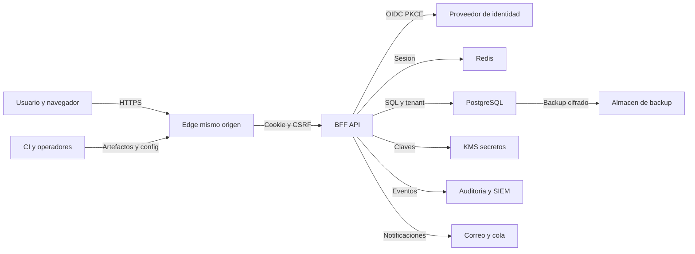

# Modelo de amenazas de NexaSalud

**Estado:** modelo inicial basado en el repositorio  
**Fecha de corte:** 19 de julio de 2026  
**Versión:** 0.1  
**Propietario pendiente:** responsable de seguridad/producto

> Este documento no certifica la seguridad, el cumplimiento normativo ni la aptitud para tratar datos reales. Distingue controles implementados de requisitos de diseño. Debe actualizarse cuando cambien los flujos, integraciones, exposición o modelo de despliegue.

## Resumen ejecutivo

NexaSalud pretende gestionar citas y datos identificativos y sanitarios en un entorno multi-tenant. Sus riesgos dominantes son el acceso cruzado entre clínicas o pacientes, la toma de cuentas del personal, la exfiltración mediante sesión/navegador/exportaciones/registros y la alteración de citas por autorización o concurrencia defectuosa. La arquitectura prevista —Angular en navegador, BFF NestJS/Fastify, OIDC, sesiones opacas en Redis, PostgreSQL con RLS y cifrado de campos— es adecuada como defensa en profundidad, pero en la fecha de corte buena parte de ella es diseño y scaffold, no evidencia de control operativo. El riesgo residual es **inaceptable para datos sanitarios reales** hasta que identidad, autorización, RLS, cifrado, auditoría, restauración y pruebas negativas estén implementados y verificados.

## Convenciones de evidencia

| Marca | Significado                                                                      |
| ----- | -------------------------------------------------------------------------------- |
| **E** | Evidenciado en código o configuración versionada. No implica prueba de eficacia. |
| **D** | Decisión o requisito de diseño documentado, todavía no demostrable como control. |
| **P** | Pendiente de implementación, configuración externa o prueba.                     |

Las referencias a `PLAN_MAESTRO.md` y `PROMPT_INTERNO_IMPLEMENTACION.md` son evidencia de intención (**D**), no de mitigación existente.

## Alcance y supuestos

### Dentro de alcance

- `apps/web`: aplicación Angular 21 que se ejecutará en el navegador.
- `apps/api`: manifiesto del BFF/API NestJS 11 sobre Fastify 5 y sus dependencias de seguridad/datos.
- Configuración raíz del workspace y comandos operativos.
- Arquitectura prevista de PostgreSQL, Redis, OIDC/Keycloak, correo, observabilidad, KMS y backups, aunque sus implementaciones aún puedan estar pendientes.
- Flujos de autenticación, agenda, pacientes, exportación, configuración, auditoría y break-glass descritos en los documentos raíz.

### Fuera de alcance por ahora

- Dispositivos médicos, diagnóstico clínico y prescripción.
- Subida de archivos; el diseño la excluye de la primera versión.
- Integraciones aún no elegidas: historia clínica, facturación, videollamada, calendarios, SMS y proveedor de correo productivo.
- Seguridad física, endpoints del personal y controles corporativos no descritos en el repositorio.
- Evaluación jurídica, certificación o auditoría de un despliegue real.

### Supuestos que condicionan la prioridad

- La producción será accesible por Internet mediante HTTPS y servirá a varias clínicas; por tanto, se modela un atacante remoto sin credenciales y un usuario autenticado de un tenant distinto.
- Angular y BFF compartirán origen en producción; el proxy de desarrollo de `apps/web/proxy.conf.json` solo es una comodidad local.
- El proveedor OIDC gestionará credenciales, MFA/passkeys y recuperación; NexaSalud no recibirá contraseñas.
- Redis será la fuente de verdad de sesiones y PostgreSQL la de datos de negocio. No habrá fallback en memoria para producción.
- Se utilizarán exclusivamente datos sintéticos hasta completar los gates de `production-readiness.md`.
- Los controles descritos solo se consideran existentes cuando haya código, configuración, prueba y evidencia de ejecución.

### Preguntas abiertas que pueden cambiar el riesgo

1. ¿Qué países, número de clínicas/usuarios y categoría exacta de datos tendrá el despliegue?
2. ¿Qué IdP, hosting, KMS, SIEM y operadores de backup se aprobarán, con qué residencia y contratos?
3. ¿Cuáles son RPO/RTO, retención, política break-glass y obligaciones de historia clínica aplicables?

Mientras no se respondan, se adopta el escenario conservador de aplicación sanitaria multi-tenant expuesta a Internet.

## Modelo del sistema

### Componentes primarios

| Componente                      | Función prevista                                                                            | Estado y evidencia                                                                                                                                |
| ------------------------------- | ------------------------------------------------------------------------------------------- | ------------------------------------------------------------------------------------------------------------------------------------------------- |
| Navegador + Angular             | UI, rutas, formularios y estado visual; nunca autoridad de seguridad                        | **E:** Angular/Material y proxy local en `apps/web/package.json` y `apps/web/proxy.conf.json`. **P:** flujos de negocio y seguridad verificables. |
| BFF/API NestJS + Fastify        | Terminación de sesión, autorización, validación, negocio, auditoría y acceso a dependencias | **E:** dependencias declaradas en `apps/api/package.json`. **P:** eficacia de guards, rutas y controles.                                          |
| Proveedor OIDC / Keycloak local | Autenticación, passkeys/MFA, recuperación y step-up                                         | **D:** flujo en `PROMPT_INTERNO_IMPLEMENTACION.md`, sección “Arquitectura de identidad”. **P:** realm y proveedor productivo.                     |
| Redis                           | Sesiones, transacciones OIDC, rate limits y locks breves                                    | **D:** arquitectura en `PLAN_MAESTRO.md` §4.3. **E:** cliente declarado en `apps/api/package.json`. **P:** despliegue/configuración.              |
| PostgreSQL                      | Fuente de verdad, integridad, tenant y RLS                                                  | **D:** `PLAN_MAESTRO.md` §4.4. **E:** cliente declarado en `apps/api/package.json`. **P:** esquema, migraciones y políticas verificadas.          |
| KMS/gestor de secretos          | Protección y rotación de claves/secretos                                                    | **D:** `PLAN_MAESTRO.md` §4.4 y §5.5. **P:** proveedor, políticas y operación.                                                                    |
| Correo/cola                     | Recordatorios y avisos sin contenido sanitario innecesario                                  | **D:** Mailpit local y adaptador productivo en `PLAN_MAESTRO.md`. **P:** implementación y proveedor.                                              |
| Logs, auditoría y SIEM          | Detección, investigación y trazabilidad sin PHI                                             | **D:** `PLAN_MAESTRO.md` §5.5 y prompt, “Logs/auditoría”. **P:** sink separado, alertas e integridad.                                             |
| CI/registro de artefactos       | Construcción, pruebas, SCA, SBOM y publicación                                              | **D:** gates en `PROMPT_INTERNO_IMPLEMENTACION.md`. **P:** pipeline y attestations.                                                               |

### Flujos y límites de confianza

| Límite                    | Origen → destino                          | Datos                                             | Canal y garantías requeridas                       | Validación y fallo seguro                                                                                      |
| ------------------------- | ----------------------------------------- | ------------------------------------------------- | -------------------------------------------------- | -------------------------------------------------------------------------------------------------------------- |
| TB-01 Internet            | Navegador → edge/BFF                      | Cookie opaca, CSRF, DTO, consultas                | HTTPS; mismo origen; límites; cabeceras            | Esquema estricto, autorización por recurso, `Origin`, rate limit; rechazar por defecto.                        |
| TB-02 Código no confiable | API → Angular/DOM                         | Perfil mínimo, citas, pacientes, errores          | JSON; CSP; no cache sensible                       | Encoding contextual; sin HTML arbitrario; errores estables; nunca tokens/PHI en storage o URL.                 |
| TB-03 Federación          | BFF ↔ IdP                                 | `state`, `nonce`, PKCE, código, claims, logout    | OIDC Authorization Code + PKCE, TLS, issuer exacto | Firma, issuer, audience, `state`, `nonce`, timestamps, `acr/amr`, redirect allowlisted; no login si falla.     |
| TB-04 Sesión              | BFF ↔ Redis                               | Sesión, tenant, actor, permisos, CSRF, revocación | Red privada/TLS o socket controlado, auth          | TTL, rotación, clave de namespace, timeouts; sin fallback; 503/401 cerrado.                                    |
| TB-05 Datos               | BFF ↔ PostgreSQL                          | PII/PHI, citas, permisos, auditoría               | Conexión cifrada en producción; cuenta mínima      | SQL parametrizado, transacción, `SET LOCAL` de actor/tenant, RLS, constraints; rollback en error.              |
| TB-06 Claves              | BFF ↔ KMS/secret manager                  | KEK, claves versionadas, credenciales             | Identidad de workload y TLS                        | Acceso mínimo, versión y auditoría; lectura/escritura sensible falla cerrada si KMS no responde.               |
| TB-07 Mensajería          | BFF/worker → correo                       | Destino y plantilla minimizada                    | API/SMTP autenticado y cifrado                     | Plantillas allowlisted, outbox idempotente; una caída no deshace la cita ni simula entrega.                    |
| TB-08 Observabilidad      | Servicios → logs/SIEM                     | Metadatos técnicos y eventos seudonimizados       | Transporte autenticado/cifrado                     | Allowlist/redacción antes del sink; operaciones de alto riesgo fallan si no pueden auditarse de forma durable. |
| TB-09 Operación           | Operador/CI → runtime                     | Artefactos, config, migraciones, secretos         | Canal administrativo separado                      | MFA, aprobación, artefactos firmados, separación de funciones, rollback; nunca secretos en Git/log.            |
| TB-10 Backup              | PostgreSQL/KMS → almacén backup → restore | Copia cifrada y metadatos                         | Canal cifrado, cuenta separada, inmutabilidad      | Cifrado, catálogo, retención, restore aislado y prueba RLS; no restaurar sobre producción sin aprobación.      |

#### Diagrama

## Activos y objetivos de seguridad

| Activo                                         | Por qué importa                                                   | Objetivo C/I/A                |
| ---------------------------------------------- | ----------------------------------------------------------------- | ----------------------------- |
| Identidad, contacto y datos demográficos       | Identifican personas y permiten fraude o daño                     | C alta, I alta, A media       |
| Motivo, notas y alertas sanitarias             | Datos especialmente sensibles; exposición puede causar daño grave | C crítica, I crítica, A alta  |
| Citas, disponibilidad y recursos               | Afectan continuidad asistencial y operación de la clínica         | C alta, I crítica, A alta     |
| Sesiones, transacciones OIDC y CSRF            | Su robo permite actuar como otra persona                          | C crítica, I crítica, A alta  |
| Roles, permisos, tenant y relación asistencial | Mantienen el aislamiento y el mínimo privilegio                   | C media, I crítica, A alta    |
| Claves, secretos y recovery material           | Compromiso amplifica el acceso a todo el sistema                  | C crítica, I crítica, A alta  |
| Eventos de auditoría y seguridad               | Permiten atribución, detección e investigación                    | C alta, I crítica, A alta     |
| Exportaciones, backups y restauraciones        | Concentraciones masivas de datos                                  | C crítica, I crítica, A alta  |
| Configuración, migraciones y artefactos        | Definen comportamiento y confianza del runtime                    | C alta, I crítica, A alta     |
| Redis, PostgreSQL, IdP y BFF                   | Dependencias críticas de disponibilidad y control                 | C/I/A según contenido; A alta |

## Modelo del atacante

### Capacidades

- Atacante remoto puede enviar peticiones arbitrarias, manipular IDs, parámetros, cabeceras, métodos, tiempos, concurrencia y flujos OIDC.
- Puede alojar una web maliciosa, realizar phishing, credential stuffing, CSRF y provocar al usuario autenticado a seguir enlaces.
- Un usuario legítimo puede pertenecer a otro tenant o tener un rol de bajo privilegio y conocer identificadores propios.
- Un insider puede abusar de acceso válido, exportar, buscar masivamente o usar break-glass.
- Una dependencia, cuenta CI, proveedor o backup puede ser comprometido.
- Un atacante con XSS puede ejecutar con los privilegios del origen y leer datos accesibles a la sesión, aunque no una cookie `HttpOnly`.

### No capacidades asumidas

- No se presupone acceso físico al datacenter, al dispositivo desbloqueado del usuario ni al KMS administrador.
- No se presupone ruptura de TLS, AES-GCM, firmas OIDC o primitivas CSPRNG bien implementadas.
- No se presupone control del IdP, CI o un operador; se modelan como escenarios de supply chain/insider separados.
- No hay uploads ni URLs de fetch arbitrarias en v1; si se añaden, requieren revisión específica de archivos/SSRF.

## Puntos de entrada y superficies

| Superficie                       | Cómo se alcanza              | Límite            | Notas                                                    | Evidencia                                                          |
| -------------------------------- | ---------------------------- | ----------------- | -------------------------------------------------------- | ------------------------------------------------------------------ |
| Rutas Angular                    | Navegación desde Internet    | TB-01/TB-02       | Guards solo mejoran UX; no autorizan                     | `apps/web/src/app/app.routes.ts`; diseño en `PLAN_MAESTRO.md` §4.2 |
| `/auth/login`, callback y logout | Redirección BFF/IdP          | TB-01/TB-03       | `returnTo`, `state`, `nonce`, PKCE y logout son críticos | Diseño en `PROMPT_INTERNO_IMPLEMENTACION.md` “Flujo”               |
| `/api/session`                   | Cookie del navegador         | TB-01/TB-04       | Perfil mínimo y CSRF; no tokens federados                | Diseño en el mismo flujo de identidad                              |
| API de citas/pacientes           | JSON autenticado             | TB-01/TB-05       | BOLA, concurrencia, validación y minimización            | Entidades y casos obligatorios en `PLAN_MAESTRO.md` §4.5 y §7.2    |
| Búsqueda                         | Consultas autenticadas       | TB-01/TB-05       | Enumeración/exfiltración y DoS                           | `PLAN_MAESTRO.md` §6 y prompt “API”                                |
| Exportación                      | Operación privilegiada y job | TB-01/TB-05/TB-10 | Requiere permiso, step-up, límites y auditoría           | `PLAN_MAESTRO.md` §3 y §7.2                                        |
| Gestión de roles/tenant          | UI/API administrativa        | TB-01/TB-05       | Escalada y acceso cruzado                                | Prompt “Autorización y multi-tenancy”                              |
| Break-glass                      | Acción privilegiada          | TB-01/TB-03/TB-08 | Motivo, tiempo, alerta y revisión                        | Mismo apartado del prompt                                          |
| Configuración de entorno         | Startup/operador             | TB-09             | Secretos, orígenes, proxy y límites                      | `apps/api/.env.example`                                            |
| Dependencias y build             | Registro npm/CI              | TB-09             | Scripts, typosquatting, artefactos                       | `apps/web/package.json`, `apps/api/package.json`, lockfiles        |
| Backup/restore                   | Tarea operativa              | TB-10             | Exfiltración o restauración corrupta                     | Requisito en `PLAN_MAESTRO.md` §6                                  |

## Principales caminos de abuso

1. **Acceso cross-tenant:** usuario de clínica A obtiene un UUID de B → cambia ID/ruta/body → la API confía en el cliente o filtra sin RLS → lee o modifica paciente/cita de B.
2. **Toma de cuenta:** atacante suplanta el IdP o explota recuperación débil → supera un factor de menor garantía → obtiene sesión de personal → busca y exporta datos masivamente.
3. **Fijación/secuestro de sesión:** atacante fuerza/reutiliza un identificador → no se rota al login/step-up → hereda identidad o privilegios y opera hasta el timeout.
4. **CSRF:** usuario autenticado visita sitio malicioso → se envía mutación con cookie → falta token/origen → se cancela, crea o exporta en nombre del usuario.
5. **XSS almacenado:** texto de paciente/cita llega a un sink HTML → se ejecuta en origen → lee respuestas clínicas y realiza mutaciones con la sesión.
6. **Exportación/registro como canal lateral:** insider autorizado inicia consultas/exportaciones amplias → datos aparecen en job, archivo, logs o telemetría → salen del perímetro sin alerta.
7. **Escalada por contexto manipulable:** cliente envía `role`, `tenant_id`, `clinic_id` o `acr` → servicio los acepta → obtiene funciones administrativas o clínicas.
8. **Doble reserva/corrupción:** dos peticiones pasan el check previo simultáneamente → no existe constraint/lock/idempotencia → ambas confirman el mismo recurso.
9. **Compromiso de dependencia/CI:** paquete o cuenta de publicación es alterado → build incorpora código malicioso → roba datos del navegador o secretos de runtime.
10. **Fallo de dependencia convertido en bypass:** Redis/KMS/auditoría cae → código usa valores por defecto, sesión local o plaintext → la operación sensible continúa sin controles.

## Tabla del modelo de amenazas

| ID     | Fuente                                 | Prerrequisitos                                | Acción                                                | Impacto y activos                              | Controles existentes                                                     | Brechas                                                 | Mitigaciones concretas                                                                                                             | Detección                                                                         | Prob.      | Severidad | Prioridad                                   |
| ------ | -------------------------------------- | --------------------------------------------- | ----------------------------------------------------- | ---------------------------------------------- | ------------------------------------------------------------------------ | ------------------------------------------------------- | ---------------------------------------------------------------------------------------------------------------------------------- | --------------------------------------------------------------------------------- | ---------- | --------- | ------------------------------------------- |
| TM-001 | Atacante remoto/phisher                | Cuenta objetivo y flujo de identidad expuesto | Toma cuenta mediante phishing, stuffing o recovery    | Exfiltración/alteración; identidad, PHI, citas | **D:** OIDC, passkeys/MFA y step-up (`PROMPT_INTERNO_IMPLEMENTACION.md`) | IdP/política/pruebas no evidenciados                    | MFA obligatorio; passkey preferida; recovery de un uso; rate limit por cuenta+IP; step-up y revocación                             | Fallos por cuenta/IP, factor degradado, nuevo dispositivo, export tras login      | Alta       | Alta      | **critical** hasta verificar; después alta  |
| TM-002 | Remoto/XSS/red local comprometida      | Sesión válida o fijable                       | Roba, fija o reutiliza sesión                         | Suplantación; sesión y datos accesibles        | **D:** cookie opaca `__Host-`, Redis, rotación/TTL                       | Ciclo de vida y detección no evidenciados               | 256 bits CSPRNG; HttpOnly/Secure/SameSite; rotar login/step-up/tenant; idle+absolute; revocación inmediata; `no-store`             | Reuso tras rotación, geovelocidad prudente, sesiones concurrentes, logout fallido | Media      | Alta      | **high**                                    |
| TM-003 | Usuario de otro tenant o rol bajo      | Sesión legítima y un ID/endpoint              | BOLA/IDOR o consulta sin aislamiento                  | Lectura/modificación cross-tenant; PHI y citas | **D:** tenant de sesión, permisos contextuales y RLS                     | Esquema/RLS/tests negativos no evidenciados             | Guard central + policy por recurso; transacción con `SET LOCAL`; RLS `FORCE`; UUID no enumerable; pruebas A/B por cada repositorio | Evento `cross_tenant_denied`, ratios 403/404, consultas sin contexto              | Alta       | Alta      | **critical**                                |
| TM-004 | Usuario autenticado/cliente manipulado | Endpoint administrativo o contexto débil      | Inyecta rol, tenant, clínica o nivel MFA              | Escalada; autorización y configuración         | **D:** deny-by-default RBAC/ABAC                                         | Enforcement server-side no evidenciado                  | Ignorar autoridad del body; claims mapeados con allowlist; permiso+recurso+relación; step-up; separación admin plataforma/PHI      | Cambios de rol, tenant switches, intentos de atributos prohibidos                 | Media      | Alta      | **high**                                    |
| TM-005 | Sitio malicioso                        | Víctima autenticada con cookie                | Fuerza mutación CSRF                                  | Alteración/exportación; citas y datos          | **D:** token sincronizador + Origin/SameSite                             | Middleware/pruebas no evidenciados                      | Token ligado a sesión; header; Origin exacto; Fetch Metadata; content-type allowlist; nunca mutar por GET                          | Rechazos CSRF por origen/ruta sin registrar token                                 | Media      | Alta      | **high**                                    |
| TM-006 | Paciente/usuario con campo de texto    | Contenido se muestra en Angular o plantilla   | XSS reflejado/almacenado                              | Robo de respuestas y acciones como víctima     | **D:** sanitización Angular/CSP; **E:** framework Angular                | CSP/sinks/pruebas no evidenciados                       | Sin `innerHTML`/bypass; encoding; CSP header sin unsafe eval/inline; Trusted Types compatible; plantillas de texto                 | CSP reports sin payload sensible, detección de sinks/SAST                         | Media      | Alta      | **high**                                    |
| TM-007 | Remoto/autenticado                     | Input llega a SQL/filtro dinámico             | Inyección o consulta no acotada                       | Exfiltración/corrupción/DoS; DB                | **D:** SQL parametrizado y schema estricto; **E:** `pg` declarado        | Capa de acceso y validación no evidenciadas             | Parametrización; no concatenar SQL; DTO allowlist; cuenta DB mínima; timeouts/paginación                                           | Errores SQL agrupados, patrones anómalos, queries lentas                          | Media      | Alta      | **high**                                    |
| TM-008 | Insider/proceso comprometido           | Permiso de búsqueda/export/log/backup         | Extrae volumen o introduce PHI en canales secundarios | Brecha masiva; export, log, backup             | **D:** step-up, auditoría, redacción y backup cifrado                    | DLP, retención, sink, restore y alertas no evidenciados | Límite y justificación; export cifrada/expirable; allowlist logs; backups separados e inmutables; dual control                     | Volumen/horario/tenant inusual, export+download, acceso backup                    | Media      | Alta      | **critical** para export/backup; alta resto |
| TM-009 | Cliente concurrente/worker             | Dos mutaciones válidas simultáneas            | Reserva doble, replay o lost update                   | Integridad/operación de citas                  | **D:** idempotencia, exclusion constraint, versionado                    | Constraints/tests no evidenciados                       | Constraint temporal en PostgreSQL; transacción; idempotency key por actor+tenant; `If-Match`; 409 estable                          | Conflictos, replays, violaciones de constraint                                    | Alta       | Media     | **high**                                    |
| TM-010 | Proveedor/dependencia/CI               | Build consume paquete o secreto               | Inserta código o roba artefactos                      | Compromiso sistémico; todos los activos        | **E:** versiones/lockfile web; **D:** SCA/SBOM                           | Pipeline, provenance y secret scan no evidenciados      | Lockfile raíz; scripts allowlist; SCA por reachability; secret scan; SBOM; pin actions; firma/attestation                          | Cambio de lock, paquete nuevo, advisory explotable, hash de artefacto             | Media      | Alta      | **high**                                    |
| TM-011 | Remoto/bot/tenant abusivo              | Endpoints costosos o auth                     | Agota CPU, DB, Redis, export/búsqueda                 | Indisponibilidad                               | **E:** dependencia rate-limit; **D:** límites diferenciados              | Políticas/edge/capacidad no evidenciadas                | Rate limit por IP+actor+tenant+operación; body/timeouts; paginación; cuotas jobs; circuit breaker                                  | Saturación, latencia, colas, 429 por dimensión                                    | Alta       | Media     | **medium**                                  |
| TM-012 | Personal legítimo                      | Acceso conforme a rol o break-glass           | Curiosidad, abuso o acceso excesivo                   | Confidencialidad y confianza                   | **D:** relación asistencial, break-glass temporal, auditoría lectura     | Gobierno/revisión/alertas no evidenciados               | Mínimo privilegio; masking; reason; step-up; alertar paciente/privacidad según política; revisiones periódicas                     | Accesos fuera de turno/equipo, pacientes VIP, búsquedas masivas                   | Media      | Alta      | **high**                                    |
| TM-013 | Remoto                                 | Parámetros OIDC/redirect manipulables         | Login CSRF, callback confusion u open redirect        | Sesión equivocada, phishing, token leak        | **D:** validación issuer/aud/state/nonce/PKCE                            | Implementación exacta no evidenciada                    | Librería mantenida; discovery fijada; redirect URI exacta; `returnTo` solo ruta relativa allowlisted; transacción corta de un uso  | `state` inválido/reusado, issuer inesperado, callback repetido                    | Media      | Alta      | **high**                                    |
| TM-014 | Fallo/atacante de infraestructura      | Redis, DB, KMS o auditoría no disponible      | Activa fallback inseguro o éxito parcial              | Bypass, pérdida de auditoría o datos           | **D:** Redis debe fallar seguro; correo usa outbox                       | Matriz de fallo/pruebas no evidenciadas                 | Sin MemoryStore/plaintext; 503/rollback; negar export/roles/break-glass sin audit durable; estados idempotentes                    | Health interno, dependency errors, fallback invariant alerts                      | Media      | Alta      | **high**                                    |
| TM-015 | Operador/atacante con backup           | Acceso a copia o restore                      | Descarga, altera o restaura en destino inseguro       | Exfiltración masiva/corrupción                 | **D:** backup cifrado y restore probado                                  | Proveedor, KMS, inmutabilidad y runbook no evidenciados | Cuenta separada; cifrado con clave separada; immutability; catálogo/hash; restore aislado; dual approval                           | Lecturas/restore/export de backup, cambio retención o clave                       | Baja-media | Alta      | **high**                                    |

## Calibración de criticidad para este sistema

- **Crítica:** acceso cross-tenant repetible, bypass de autenticación, extracción masiva de PHI o compromiso de claves/backup con alcance sistémico. Ejemplos: TM-003 sin RLS/guard; export no autorizada; IdP/KMS comprometido.
- **Alta:** compromiso de una cuenta o sesión, modificación relevante de citas, XSS con acceso clínico o fallo cerrado ausente. Ejemplos: TM-001, TM-002, TM-005, TM-014.
- **Media:** degradación acotada, DoS recuperable o fuga de metadatos limitada sin PHI. Ejemplos: rate limit evadible con capacidad sobrante; enumeración de estados no identificativos.
- **Baja:** información técnica de poco valor o hardening sin camino de abuso práctico. Ejemplos: fingerprint de framework sin otra debilidad; cabecera informativa ausente.

La prioridad combina probabilidad e impacto, pero se eleva cuando el control es solo diseño. La exposición real, escala, política IdP y datos exactos pueden cambiarla.

## Riesgo residual y condiciones de aceptación

### Estado actual

**No aceptable para PII/PHI real.** Solo se autoriza demo local con personas y eventos sintéticos. Declarar una dependencia en `package.json` o una exigencia en un plan no demuestra que el control funcione.

### Riesgos que siempre permanecen

- Un endpoint comprometido o usuario privilegiado conserva capacidad de abuso; auditoría y alertas reducen, no eliminan, el riesgo insider.
- El navegador debe mostrar PHI autorizada y por ello XSS/dispositivo comprometido conservan impacto elevado.
- IdP, KMS, proveedores y backups amplían la cadena de confianza.
- MFA no elimina phishing de sesión, fatiga, malware ni recuperación débil.
- RLS no sustituye autorización funcional y esta no sustituye RLS.

### Condiciones mínimas antes de aceptar datos reales

- TM-001 a TM-015 tienen owner, prueba y evidencia; ningún crítico/alto queda abierto sin aceptación formal y compensación.
- Flujo OIDC/MFA/passkey, sesión, CSRF, revocación y step-up probado extremo a extremo.
- Matriz BOLA/RBAC/ABAC/RLS negativa entre roles y dos tenants, incluida consulta y exportación.
- Cifrado de campos/backup, rotación y restore aislado demostrados.
- Redacción de logs verificada observando recorridos reales; auditoría durable y alertas operativas.
- SCA/SAST/secret scan/SBOM, cabeceras, ZAP y pruebas de concurrencia verdes.
- DPIA/privacidad, residencia, retención, contratos, RPO/RTO y respuesta a incidentes aprobados por responsables competentes.

## Matriz de amenazas y ASVS 5.0.0

Esta tabla es una guía de evidencia, no una evaluación ASVS ni una certificación.

| Área ASVS 5.0.0                         | Amenazas                               | Evidencia esperada                                                            |
| --------------------------------------- | -------------------------------------- | ----------------------------------------------------------------------------- |
| V1 Encoding and Sanitization            | TM-006, TM-007                         | Revisión de sinks, parametrización, tests de payloads y CSP efectiva          |
| V2 Validation and Business Logic        | TM-007, TM-009, TM-011                 | Esquemas estrictos, constraints, idempotencia, límites y concurrencia         |
| V3 Web Frontend Security                | TM-002, TM-005, TM-006                 | Storage/caché, CSRF, CSP, Trusted Types y pruebas de navegador                |
| V4 API and Web Service                  | TM-003, TM-004, TM-007, TM-011         | Inventario de rutas, autorización por recurso, límites, errores y contrato    |
| V6 Authentication                       | TM-001                                 | Política IdP, MFA/passkeys, recovery, anti-enumeración y pruebas              |
| V7 Session Management                   | TM-002, TM-014                         | Cookie, Redis, rotación, expiración, revocación y fallos de dependencia       |
| V8 Authorization                        | TM-003, TM-004, TM-012                 | Matriz de permisos/atributos, RLS, break-glass y tests negativos              |
| V9 Self-contained Tokens                | TM-002, TM-013                         | Evidencia de que tokens OIDC no son sesión del navegador y validación interna |
| V10 OAuth and OIDC                      | TM-001, TM-013                         | PKCE, state, nonce, issuer/audience, redirect, logout y step-up               |
| V11 Cryptography                        | TM-008, TM-015                         | Diseño AEAD, nonces/AAD, KMS, versionado y pruebas de rotación                |
| V12 Secure Communication                | TM-002, TM-008, TM-015                 | TLS externo/interno, validación de certificado y topología proxy              |
| V13 Configuration                       | TM-010, TM-014                         | Config tipada, secretos, hardening, fail-closed y separación de entornos      |
| V14 Data Protection                     | TM-003, TM-006, TM-008, TM-012, TM-015 | Clasificación, minimización, caché, export, logs, backup y retención          |
| V15 Secure Coding and Architecture      | Todas                                  | Threat model vivo, gates, separación y defensa en profundidad                 |
| V16 Security Logging and Error Handling | TM-008, TM-012, TM-014                 | Catálogo de eventos, redacción, integridad, alertas y errores no reveladores  |

Referencia estable: [OWASP ASVS 5.0.0](https://github.com/OWASP/ASVS/tree/v5.0.0).

## Rutas prioritarias para revisión de seguridad

| Ruta                         | Motivo                                                     | Amenazas                       |
| ---------------------------- | ---------------------------------------------------------- | ------------------------------ |
| `apps/api/src/auth/`         | Callback OIDC, sesión, CSRF y logout cuando exista         | TM-001, TM-002, TM-005, TM-013 |
| `apps/api/src/common/`       | Guards, contexto, validación, errores y logs transversales | TM-003, TM-004, TM-007, TM-014 |
| `apps/api/src/database/`     | Conexión, transacciones, tenant y migraciones              | TM-003, TM-007, TM-009         |
| `apps/api/src/appointments/` | Autorización de recursos, concurrencia e idempotencia      | TM-003, TM-009                 |
| `apps/api/src/patients/`     | Minimización y separación básica/sensible                  | TM-003, TM-006, TM-012         |
| `apps/api/src/exports/`      | Step-up, volumen, archivos y auditoría                     | TM-008, TM-012, TM-015         |
| `apps/api/src/audit/`        | Redacción, integridad y fallos                             | TM-008, TM-012, TM-014         |
| `apps/web/src/app/`          | Sinks DOM, almacenamiento, guards y caché                  | TM-002, TM-005, TM-006         |
| `infra/`                     | Red, credenciales, IdP, RLS, backups y health              | TM-001, TM-003, TM-014, TM-015 |
| Lockfiles y CI               | Dependencias, scripts, secrets y provenance                | TM-010                         |

Las rutas inexistentes son **focos de implementación/revisión**, no evidencia de que ya existan.

## Checklist de calidad del modelo

- [x] Se diferenciaron runtime, desarrollo/CI e integraciones futuras.
- [x] Se cubrieron navegador, auth, API, datos, cache, claves, mensajería, observabilidad, operación y backup.
- [x] Cada límite de confianza aparece al menos en un camino de abuso o amenaza.
- [x] Se modelaron atacante remoto, usuario cross-tenant, insider, proveedor y fallo de dependencia.
- [x] Las decisiones documentadas están marcadas como diseño, no como control existente.
- [x] Se registraron supuestos y preguntas que alteran el riesgo.
- [x] No se incluyeron secretos ni datos de pacientes reales.
- [ ] Revalidar contra rutas y migraciones definitivas.
- [ ] Asignar owner, fecha y evidencia ejecutable a cada amenaza.
- [ ] Validar el contexto con producto, operaciones, privacidad y asesoría jurídica.
- [ ] Actualizar tras pruebas de penetración y antes de cada cambio material.
