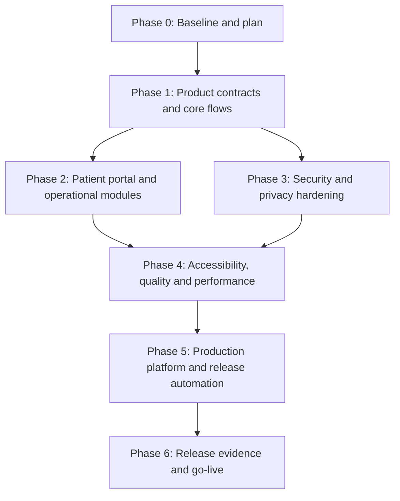

# Production Readiness Plan: NexaSalud

## Objective

Deliver NexaSalud as a production-ready clinical appointment platform. "Ready" means that a defined functional scope is complete end to end, security controls are evidenced, operations are repeatable, and release gates can reject an unsafe build. It does not mean a legal or clinical certification is assumed without review by the accountable organisation.

## Baseline and planning rules

- The application is an Angular 21 frontend and Laravel 13 BFF/API, with PostgreSQL, Redis, Keycloak and Docker Compose for local development.
- The local stack and automated unit/feature suites are already operational. The current baseline is 85 Laravel tests and 47 Angular tests.
- Laravel Boost is installed as a development dependency. Its MCP configuration is prepared to run through the local Docker API container; a fresh Codex session must load the project configuration to use it.
- PHPDoc coverage of `apps/api/app` has been completed manually. Future backend changes must retain English Laravel-style DocBlocks ending with a period.
- Every product capability is delivered as a vertical slice: authorization, validation, persistence, API resource, Angular client/UI, audit trail, automated tests, and accessible error/loading states.
- No phase may be declared complete solely because screens render. Its acceptance criteria and checkpoint must pass.

## Architecture decisions

- Keep Laravel as the sole authorization boundary and Angular guards as UX only.
- Keep OIDC Authorization Code + PKCE with server-side sessions. Tokens and clinical data must not be persisted in browser storage.
- Treat Docker Compose as local/development tooling. Production requires a separate deployment topology, TLS termination, external secret management, backups, observability and an incident runbook.
- Use PostgreSQL constraints and transactional domain services for conflicts and tenant isolation; do not rely on frontend validation for integrity.
- Maintain an explicit out-of-scope register for regulatory decisions, payment-provider contracts, SMS contracts and clinical policy rules that require product-owner approval.

## Delivery dependency graph

## Phase 0: Baseline, contracts and controlled tooling

### Task 0.1: Freeze and record the verified baseline

**Description:** Capture dependency versions, test results, known scope gaps and the local runtime assumptions before making more product changes.

**Acceptance criteria:**

- [x] Local Laravel, Angular and Docker commands are documented and reproducible.
- [x] Production and development dependency audits have no known vulnerabilities at the selected audit thresholds.
- [x] The baseline test counts and remaining gaps are recorded in this plan and backlog.

**Verification:** `composer validate --strict`, `composer audit --locked --no-dev`, `pnpm audit --audit-level moderate`, backend tests, frontend typecheck/tests/build.

**Dependencies:** None.

### Task 0.2: Make the Laravel Boost MCP usable in the monorepo

**Description:** Configure the Codex MCP to invoke `php artisan boost:mcp` through the `api` Docker container and validate the JSON-RPC handshake.

**Acceptance criteria:**

- [x] `laravel/boost` is present in Composer development dependencies.
- [x] Project configuration contains the Docker-backed `laravel-boost` MCP entry.
- [x] The Docker-backed server returns a successful MCP `initialize` JSON-RPC response.

**Verification:** Start the Compose stack and send an MCP `initialize` request to the configured Docker command; retain the successful response without exposing secrets. A fresh Codex session will load this project configuration automatically.

**Dependencies:** Task 0.1.

### Checkpoint 0

- [ ] The plan has been reviewed by the product owner.
- [ ] Scope decisions for payments, communications, prescription workflow and privacy requests have named owners.
- [ ] No implementation task starts without a test and a concrete acceptance condition.

## Phase 1: Contracts and critical appointment flows

### Task 1.1: Reconcile OpenAPI with the implemented API

**Description:** Establish a versioned API contract for the routes used by Angular and validate it in CI.

**Acceptance criteria:**

- [ ] Every browser-consumed endpoint has documented request, response and error schemas.
- [ ] Tenant, authorization and pagination semantics are explicit.
- [ ] Generated TypeScript types or contract tests detect backend/frontend drift.

**Verification:** Schema validation and a CI contract check for representative API responses.

**Dependencies:** Task 0.1.

### Task 1.2: Complete appointment lifecycle transitions

**Description:** Implement and test the complete transition policy for pending, confirmed, arrived, waiting, in consultation, completed, cancelled and no-show appointments.

**Acceptance criteria:**

- [ ] Invalid state transitions are rejected server-side with stable problem responses.
- [ ] Every valid transition enforces role, clinic scope, concurrency/version checks and audit events.
- [ ] Agenda UI offers only permitted transitions and renders conflict recovery.

**Verification:** Laravel feature tests for all transitions and Angular interaction tests for permitted and denied actions.

**Dependencies:** Task 1.1.

### Task 1.3: Make reschedule, cancellation and availability conflict-safe

**Description:** Complete the booking workflow around availability, policy windows, idempotency and concurrent edits.

**Acceptance criteria:**

- [ ] Double booking of practitioner, room or constrained resource is prevented by database-backed logic.
- [ ] Cancellation and rescheduling enforce the configured policy and retain an auditable reason.
- [ ] UI exposes an accessible error path and refreshes stale availability after a conflict.

**Verification:** Concurrent Laravel tests, API idempotency tests, and browser E2E coverage of booking/rescheduling.

**Dependencies:** Tasks 1.1 and 1.2.

### Checkpoint 1

- [ ] Appointment creation, change and cancellation work end to end for each supported role.
- [ ] API contract and frontend builds pass.
- [ ] A clinical product owner validates the state and policy semantics.

## Phase 2: Complete product vertical slices

### Task 2.1: Finish the patient portal self-service scope

**Description:** Complete the patient-owned flows currently visible in the portal: appointment management, waitlist, privacy/export request, invoice access, prescription renewal request and help.

**Acceptance criteria:**

- [ ] Each enabled portal action is backed by a patient-scoped API endpoint, policy and audit event.
- [ ] A patient can never enumerate or alter another patient's information.
- [ ] Every action has loading, validation, success and failure states that work by keyboard and on small screens.

**Verification:** Laravel ownership tests, Angular component tests and E2E tests with two distinct patient identities.

**Dependencies:** Checkpoint 1.

### Task 2.2: Complete waitlist matching and offer lifecycle

**Description:** Extend the existing waitlist creation/listing flow with deterministic matching, expiring offers, acceptance/rejection and appointment conversion.

**Acceptance criteria:**

- [ ] Matching respects clinic, type, window, allowed preferences and configured priority policy.
- [ ] Offer expiry and conversion are atomic and cannot create duplicate bookings.
- [ ] Staff and patient views only reveal the minimum necessary data and all decisions are audited.

**Verification:** Clock-controlled Laravel tests, queue/worker tests, and UI tests for each offer status.

**Dependencies:** Task 1.3.

### Task 2.3: Complete patient, consent and clinical-context boundaries

**Description:** Finish patient administration capabilities required for scheduling without expanding into an uncontrolled electronic health record.

**Acceptance criteria:**

- [ ] Patient create/update/search has scoped authorization, duplicate detection and data minimization.
- [ ] Consent capture, withdrawal and version history are immutable/audited as appropriate.
- [ ] Sensitive fields are masked in listings and reveal actions require the defined permission and rationale.

**Verification:** Policy and feature tests for cross-clinic denial, audit assertions, and accessibility tests for forms.

**Dependencies:** Tasks 1.1 and 1.2.

### Task 2.4: Complete communications and reminders

**Description:** Implement provider-agnostic, consent-aware reminders and internal notifications with delivery observability.

**Acceptance criteria:**

- [ ] Templates use an allowlisted variable set and cannot introduce clinical content into unsafe channels.
- [ ] Communication preferences, retries, bounce/failure handling and opt-out behaviour are enforced.
- [ ] Delivery attempts are idempotent, observable and auditable.

**Verification:** Queue tests, provider adapter contract tests and Mailpit E2E checks in development.

**Dependencies:** Task 2.3.

### Task 2.5: Complete billing and invoice artefacts or formally remove them from scope

**Description:** Decide and implement the supported payment/invoice flow, rather than retaining decorative UI or placeholder claims.

**Acceptance criteria:**

- [ ] Product owner selects the payment model and provider, or the feature is hidden behind a documented out-of-scope decision.
- [ ] If implemented, payment webhooks are signature-verified, idempotent and reconciled server-side.
- [ ] Invoices/downloads have authorization, retention, audit and privacy controls.

**Verification:** Sandbox provider tests, webhook replay tests, and authorization tests for document download.

**Dependencies:** Product-owner decision; Task 2.1 for portal exposure.

### Checkpoint 2

- [ ] No shipped navigation item leads to an unavailable or simulated core capability.
- [ ] All enabled product modules have API ownership tests and user-facing error states.
- [ ] Open product decisions are explicitly deferred rather than implied complete.

## Phase 3: Security, privacy and compliance evidence

### Task 3.1: Threat model and security finding remediation

**Description:** Reconcile the existing threat model with the implementation, run a deep repository security scan and remediate validated findings by severity.

**Acceptance criteria:**

- [ ] Trust boundaries, assets, abuse cases and mitigating controls are evidence-backed.
- [ ] Critical and high validated findings are fixed or release-blocked with an approved exception.
- [ ] SECURITY.md, disclosure path and vulnerability response ownership are defined.

**Verification:** Security scan reports, tests for fixes and tracked findings with owners/dates.

**Dependencies:** Checkpoint 1; tasks may run alongside Phase 2 after API contracts stabilize.

### Task 3.2: Authentication, session and privileged-action hardening

**Description:** Test OIDC, session, CSRF, origin, reauthentication and MFA requirements as attack-resistant workflows.

**Acceptance criteria:**

- [ ] Session fixation, login CSRF, OIDC replay, unsafe return URLs and privilege changes are rejected.
- [ ] Production cookies use `__Host-`, Secure and appropriate SameSite settings on a single HTTPS origin.
- [ ] Reauthentication and audit rationale protect exports, role changes and sensitive reveals.

**Verification:** Negative Laravel feature tests, browser tests and configuration checks against OWASP ASVS controls.

**Dependencies:** Task 3.1.

### Task 3.3: Privacy lifecycle and data protection controls

**Description:** Implement the defined privacy request lifecycle, retention/deletion policy, encrypted sensitive data boundaries and evidence exports.

**Acceptance criteria:**

- [ ] Subject access, rectification/restriction and deletion requests have authorised, auditable workflows.
- [ ] Retention jobs are safe, reversible where required and tested against legal-hold scenarios.
- [ ] Logs, traces, backups and exports exclude or minimise health data by design.

**Verification:** Data-flow review, retention job tests and redaction tests for logging/exception paths.

**Dependencies:** Task 3.1 and product/legal-owner decisions.

### Task 3.4: Supply-chain and dependency controls

**Description:** Make dependency, action and container provenance continuously verifiable.

**Acceptance criteria:**

- [ ] CI performs dependency audit, secret scanning, SAST, SBOM generation and container vulnerability scanning.
- [ ] GitHub Actions are pinned by immutable commit SHA and updated through a controlled process.
- [ ] Production images are non-root, minimal, signed/attested and rebuilt from locked dependencies.

**Verification:** CI artefacts, SBOM inspection and a failed pipeline test on an injected vulnerable dependency.

**Dependencies:** Task 3.1.

### Checkpoint 3

- [ ] Security review has no unresolved release-blocking issue.
- [ ] Privacy owner has reviewed the evidence and outstanding legal decisions.
- [ ] No secret, token or clinical payload is emitted in test artefacts or logs.

## Phase 4: Accessibility, quality and performance

### Task 4.1: WCAG 2.2 AA audit and remediation

**Description:** Audit all authenticated, portal and error journeys and remove accessibility blockers.

**Acceptance criteria:**

- [ ] Keyboard operation, focus order, labels, errors, dialogs, tables, contrast and reduced motion pass the defined audit.
- [ ] Calendar drag/drop has an equivalent keyboard workflow.
- [ ] Automated axe checks run in CI for critical routes.

**Verification:** Automated axe suite plus manual screen-reader and keyboard test scripts.

**Dependencies:** Checkpoint 2.

### Task 4.2: Real-browser end-to-end test suite

**Description:** Add stable Playwright coverage for authentication, appointment lifecycle, portal ownership and failure recovery.

**Acceptance criteria:**

- [ ] Tests use deterministic seed data and isolated identities.
- [ ] Critical browser flows run headlessly in CI with screenshots/traces on failure.
- [ ] The suite covers unauthorized, conflict and service-unavailable paths, not only happy paths.

**Verification:** CI E2E run against the Compose test topology.

**Dependencies:** Tasks 1.2, 1.3 and 2.1.

### Task 4.3: Performance budgets and observability-safe frontend optimisation

**Description:** Establish measurable budgets for route loading, interaction responsiveness and visual stability, then remediate the largest contributors.

**Acceptance criteria:**

- [ ] LCP, INP and CLS budgets are defined for representative authenticated and portal routes.
- [ ] Bundle budgets, lazy loading and image/font delivery are enforced in CI.
- [ ] Monitoring captures errors and performance without leaking protected data.

**Verification:** Lighthouse/Web Vitals reports, Angular build budgets and synthetic monitoring output.

**Dependencies:** Task 4.2 and Task 3.3.

### Checkpoint 4

- [ ] Critical journeys meet agreed accessibility and performance thresholds.
- [ ] Every user-facing production error has a safe, useful recovery path.
- [ ] E2E tests are reliable enough to be a release gate.

## Phase 5: Production platform and operational readiness

### Task 5.1: Define production topology and infrastructure as code

**Description:** Replace development Compose assumptions with a reviewed production deployment design.

**Acceptance criteria:**

- [ ] HTTPS, HSTS, trusted proxies, single-origin routing, network segmentation and service identities are defined.
- [ ] Keycloak runs in production mode behind TLS with hardened hostname/proxy and administrator controls.
- [ ] Infrastructure, environment configuration and changes are reproducible through version-controlled IaC.

**Verification:** Staging deployment from scratch and infrastructure review.

**Dependencies:** Task 3.2.

### Task 5.2: Secrets, backups, restore and disaster recovery

**Description:** Introduce a managed secret store and prove that protected data can be recovered without exposing it.

**Acceptance criteria:**

- [ ] Secrets are injected at runtime, rotated, access-scoped and absent from repository/logs/images.
- [ ] PostgreSQL, Redis/session and Keycloak backup strategy has retention, encryption and ownership.
- [ ] A restore test meets a stated RPO/RTO and includes application-level validation.

**Verification:** Recorded staging restore exercise and secret rotation drill.

**Dependencies:** Task 5.1 and Task 3.3.

### Task 5.3: Observability, alerting and incident operations

**Description:** Instrument the application and write the operating procedures needed to detect, triage and recover from a production incident.

**Acceptance criteria:**

- [ ] Health/readiness, metrics, structured redacted logs, traces and correlation IDs are available.
- [ ] Alerts cover authentication failure spikes, queue failures, backup failures, latency, saturation and error budgets.
- [ ] Runbooks cover rollback, incident response, breach escalation, degraded dependencies and maintenance.

**Verification:** Staging failure injection and alert/runbook exercises.

**Dependencies:** Tasks 5.1 and 5.2.

### Task 5.4: Release pipeline and progressive delivery

**Description:** Build an immutable, gated delivery pipeline from source to staging and production.

**Acceptance criteria:**

- [ ] CI gates linting, tests, contracts, accessibility, E2E, SAST/SCA/SBOM and image scanning.
- [ ] Database migrations have preflight, backup, rollback/forward-fix and compatibility strategy.
- [ ] Releases support approval, canary/blue-green strategy where applicable, rollback and post-deploy smoke tests.

**Verification:** Staging release, rollback rehearsal and signed artefact inspection.

**Dependencies:** Tasks 3.4, 4.2 and 5.1.

### Checkpoint 5

- [ ] A full staging deployment, backup restore and rollback rehearsal are successful.
- [ ] On-call ownership and escalation paths are staffed.
- [ ] Release evidence is retained and linked to the candidate build.

## Phase 6: Release evidence and controlled go-live

### Task 6.1: Execute the production readiness review

**Description:** Gather evidence from all checkpoints into a release decision record.

**Acceptance criteria:**

- [ ] Every task is completed, formally deferred with owner/date, or treated as a release blocker.
- [ ] Product, security, privacy and operations owners approve their respective responsibilities.
- [ ] Known limitations and support commitments are communicated before enabling users.

**Verification:** Signed release checklist and change record.

**Dependencies:** Checkpoints 1–5.

### Task 6.2: Controlled launch and hypercare

**Description:** Launch a limited cohort, monitor it closely and expand only after objective success criteria are met.

**Acceptance criteria:**

- [ ] Rollout cohort, success metrics and abort thresholds are agreed before release.
- [ ] Monitoring and support queues are staffed for the hypercare window.
- [ ] A post-launch review produces prioritised corrective actions.

**Verification:** Launch dashboard, incident log and post-implementation review.

**Dependencies:** Task 6.1.

## Risks and mitigations

| Risk                                                | Impact   | Mitigation                                                                        |
| --------------------------------------------------- | -------- | --------------------------------------------------------------------------------- |
| Unresolved medical, privacy or payment policy       | High     | Name an accountable owner and keep related UI/API disabled until approved.        |
| Treating local Compose as production infrastructure | Critical | Build and rehearse a separate staging/production topology before release.         |
| Cross-tenant or patient data disclosure             | Critical | Policy tests, database scoping, negative E2E tests, audit and privacy review.     |
| Placeholder UI mistaken for shipped functionality   | High     | Phase 2 requires every enabled navigation capability to have an end-to-end slice. |
| Security controls not exercised under attack paths  | High     | Threat-model-driven negative tests and deep security scan remediation.            |
| Unsafe migration or failed recovery                 | Critical | Backups, migration preflight and recurring restore/rollback drills.               |
| Late accessibility defects                          | High     | Phase 4 begins audit before final UI polish and makes it a CI gate.               |

## Definition of done for each implementation task

- Automated tests first demonstrate the intended behaviour and a denied/edge case.
- Laravel code has English DocBlocks with a final period for public non-trivial code.
- Authorization, tenant scoping, validation, audit events and safe error handling are enforced server-side.
- Angular has typed API integration, responsive UI, keyboard access, loading/empty/error/success states and no fake completed action.
- Static analysis, relevant test suite and production build pass.
- Documentation, API contract and operational impact are updated.
